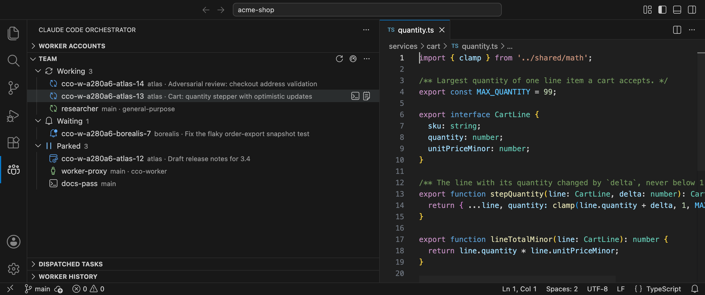
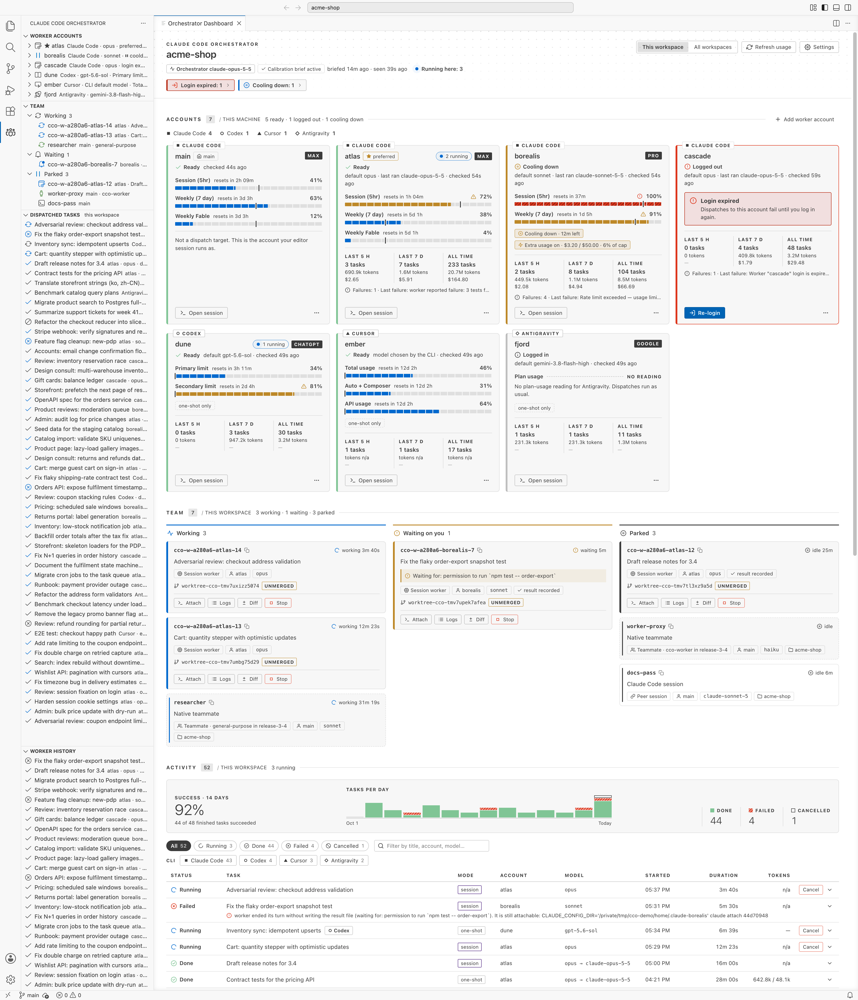
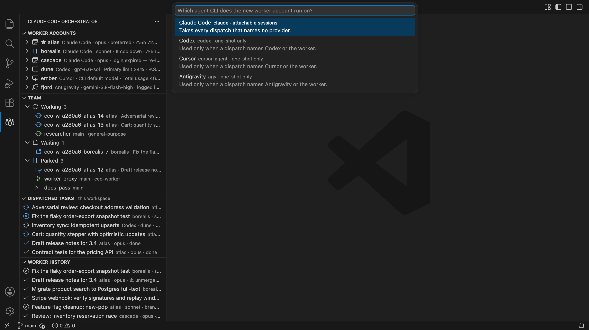

# Claude Code Orchestrator

[English](README.md) | **한국어** | [简体中文](README.zh-CN.md)

[](https://marketplace.visualstudio.com/items?itemName=toragonite.claude-code-orchestrator)
[](https://marketplace.visualstudio.com/items?itemName=toragonite.claude-code-orchestrator)
[](https://open-vsx.org/extension/toragonite/claude-code-orchestrator)
[](https://open-vsx.org/extension/toragonite/claude-code-orchestrator)
[](https://github.com/Toragonite/claude-code-orchestrator/releases/latest)
[](https://github.com/Toragonite/claude-code-orchestrator)
[](LICENSE)


> 비공식 확장입니다 — Anthropic과 무관하며 Anthropic의 보증을 받지 않았습니다. 이전 이름: *Fable Orchestrator*.

Claude Code Orchestrator는 하나의 **Claude Code** 세션(*오케스트레이터*)이 메인 세션이 자신의 Bash 도구에서 실행하는 디스패치 명령(원한다면 MCP 디스패치 도구)을 통해 코딩 작업을 **다른 계정**에서 실행되는 워커 세션에 병렬로 넘길 수 있게 해 줍니다. 메인 세션은 설계·통합·검증을 맡고 워커들은 각자의 플랜 쿼터로 구현하며, 쿼터를 고려한 페일오버, 계정별 실시간 사용량, 라이브 세션을 보여 주는 팀 뷰, 대시보드를 함께 제공합니다.

> **2.0 — Claude Code 2.1.283 이상에 맞춰 다시 정렬했습니다.**
> 세션 워커는 이제 내 세션이 `SendMessage`로 직접 메시지를 보내는 피어 세션입니다. 워커 계정을 Codex, Cursor, Antigravity에서도 실행할 수 있습니다. 팀 뷰가 생겼고 대시보드를 새로 설계했습니다. 릴레이 "게이트웨이"와 MCP 도구 3개, 설정 2개는 제거했습니다. 이제 Claude Code가 그 일을 직접 하기 때문입니다. 설정은 이제 사용자 설정에서만 읽습니다. 이제 디스패치에 MCP가 필요 없습니다. 메인 세션이 Bash 도구로 `~/.claude-code-orchestrator/bin/cco` 명령을 실행합니다. MCP는 선택 사항으로 계속 쓸 수 있습니다.
> → [1.x에서 업그레이드](#1x에서-업그레이드) · [실험적이거나 검증되지 않은 것](#실험적이거나-검증되지-않은-것) · [변경 이력](CHANGELOG.md)

```
Claude Code 패널 (메인 계정 — 오케스트레이터)                    ← 평소처럼 사용
   │  Bash 도구 → ~/.claude-code-orchestrator/bin/cco dispatch_tasks · dispatch_task · dispatch_status · list_workers · cancel · …
   ▼
디스패치 호스트 (Claude Code 세션마다 백그라운드 프로세스 하나, 내 컴퓨터에서 실행; 등록했다면 cco-dispatch MCP 서버가 같은 코드를 실행)
   │  각 워커의 CLI를 그 워커의 로그인으로, 이 워크스페이스에서 실행
   ├──────────────┬──────────────┬──────────────────────┐
   ▼              ▼              ▼                      ▼
워커 w1          워커 w2         워커 w3                 워커 codex1
Claude Code     Claude Code    Claude Code            Codex — 디스패치가 요청할 때만
(opus)          (sonnet)       (opus)                 (provider / worker)
```

핵심 아이디어: **계정은 각 벤더의 CLI가 이미 가지고 있는 로그인입니다.** Claude Code 워커는 한 번 로그인해 두는 별도의 설정 디렉터리(`~/.claude-<이름>`)이고, 다른 벤더의 CLI에서 실행되는 워커는 그 CLI의 로그인을 사용합니다. 확장은 그 CLI들을 실행할 뿐, 자격 증명을 다루지 않습니다([신뢰와 프라이버시](#신뢰와-프라이버시) 참고).

## 누구를 위한 것인가

- 코딩 에이전트 구독이 둘 이상 있고 — Claude 플랜 여러 개, 또는 Claude 플랜에 Codex·Cursor·Antigravity — 하나의 대화에서 그 쿼터를 병렬로 쓰고 싶은 분.
- 메인 세션은 설계자이자 검증자로 남기고 싶은 분: 계약을 확정하고, 구현을 분산하고, 빌드·테스트·병합을 수행합니다.
- 어느 계정이 한도에 가까운지, 로그아웃됐는지, 쿨다운 중인지, 그리고 각 워커가 지금 무엇을 하는지 한곳에서 보고 싶은 분.

호스팅 서비스가 아닙니다. 모든 것이 내 컴퓨터에서, 내가 직접 만든 로그인으로 실행됩니다.

## 스크린샷

*세션 시작: 오케스트레이터가 `orchestrator_briefing`으로 체크인한 뒤, `list_workers`에서 모든 계정의 실시간 플랜 사용량을 읽어 한도에 가까운 계정을 피해 갑니다:*


*팬아웃: 인터페이스 계약을 확정한 뒤, 한 번의 `dispatch_tasks` 호출로 독립적인 하위 작업을 워커 계정들에 병렬로 보냅니다:*


*사이드바: 워커 계정(실행되는 CLI, 로그인 상태, 실시간 플랜 사용량), 팀, 디스패치된 작업, 워커 기록:*


*팀 뷰: 여러 계정의 라이브 세션을 작업 중·대기 중·파킹됨으로 묶어 보여 주고, 행마다 연결·로그·diff·중지를 제공합니다:*



*대시보드: 사용량 게이지와 재설정 카운트다운이 있는 계정 카드, 3개 레인의 팀 보드, 활동 목록:*


*같은 대시보드의 밝은 테마 — 고대비를 포함해 에디터의 테마를 따릅니다:*



*워커 추가는 그 계정이 실행될 CLI를 고르는 것으로 시작합니다:*



## 요구 사항

- **VS Code 1.90 이상**, 또는 Open VSX에서 설치하는 호환 에디터.
- **Claude Code CLI** — 설치되어 있고 메인 계정으로 로그인되어 있어야 합니다. 2.0 릴리스는 Claude Code 2.1.283에서 검증했습니다.
- 로그인 셸의 `PATH`에 있는 **Node.js** — 디스패치 서버가 Node.js로 실행됩니다.
- **워커 계정 하나 이상:**
  - 배정할 모델을 실행할 수 있는 플랜의 또 다른 Claude 계정, 그리고/또는
  - 다른 프로바이더의 경우, 설치되어 있고 로그인된 그 벤더의 CLI: `codex`(Codex), `cursor-agent`(Cursor), `agy`(Antigravity). 세 CLI 모두에 대한 디스패치를 2026-10-14에 codex-cli 0.162.1, cursor-agent 2026.10.12, agy 1.3.4로 실제 환경에서 검증했습니다.
- **세션 워커(메시 모드, 실험적)를 쓰려면:** **macOS 또는 Linux**에서 Claude Code **2.1.283 이상**. 더 낮은 버전의 CLI나 다른 플랫폼에서는 세션 워커가 시작되지 않고, 모든 디스패치가 일회성 워커로 실행됩니다.
- **MCP 없이 디스패치하려면(기본 방식):** macOS 또는 Linux와 메인 세션의 Bash 도구가 필요합니다. `~/.claude-code-orchestrator/bin/cco`는 2.0에서 Windows에서 실행되지 않으므로, Windows에서는 MCP 서버를 사용하세요.

## 설치

- **마켓플레이스**: “Claude Code Orchestrator”를 검색하세요.
- **소스에서**: `npm install && npm run compile` 후 F5(Extension Development Host), 또는 `npm run package`로 생성된 `.vsix`를 설치합니다.

## 빠른 시작

1. 액티비티 바에서 **Claude Code Orchestrator** 뷰를 열고 **워커 계정 추가**를 실행합니다. 계정이 실행될 CLI, 이름(예: `w1`), 기본 모델을 고른 다음, 확장이 열어 주는 터미널에서 **한 번** 로그인합니다(Antigravity는 자체 앱에서 로그인합니다). 이미 `~/.claude-*` 디렉터리가 있다면 **기존 Claude 설정 디렉터리 가져오기**를 사용하세요.
2. **워크스페이스 구성 업데이트**를 실행합니다(명령 팔레트에서, 또는 대시보드의 설정 버튼, 온보딩 단계, "정책이 오래됨" 칩으로도 열 수 있습니다). 디스패치에 필요한 설정은 이것이 전부이며 MCP 서버는 관여하지 않습니다. 워크스페이스를 살펴본 뒤, 각 항목의 상태와 함께 하나의 체크리스트로 보여 줍니다. 체크한 항목만 적용하고, 항목마다 무엇을 했는지 또는 왜 거부했는지 알려 줍니다:
   - **디스패치 정책** — `CLAUDE.md`의 디스패치 정책 블록을 추가하거나 업데이트합니다.
   - **팀 프록시 에이전트** — `.claude/agents/cco-worker.md`를 추가하거나 업데이트합니다. 그 위치에 우리 것이 아닌 파일이 있으면 덮어쓰지 않습니다.
   - **권한** — `.claude/settings.local.json`에 규칙을 추가해서 `~/.claude-code-orchestrator/bin/cco`가 권한 확인 없이 실행되게 합니다.
   - **MCP 서버** — `.mcp.json`에서 `cco-dispatch` 항목을 제거합니다. 기본으로 체크되어 있지 않으며, 정책이 최신일 때만 제안합니다.

   규칙은 `Bash(~/.claude-code-orchestrator/bin/cco *)`, 홈 경로를 절대 경로로 쓴 같은 규칙(Claude Code는 두 표기를 따로 매칭합니다), 세션이 확인 없이 작업 파일을 쓸 수 있게 하는 `Edit(/.cco/**)`, 그리고 `sandbox.excludedCommands`에 넣는 두 가지 명령 표기입니다. 이 규칙은 Claude Code가 읽는 위치인 git 저장소 루트의 `.claude/settings.local.json`에 기록되며, git 밖이라면 폴더 자체의 같은 파일에 기록됩니다. 해석할 수 없는 설정 파일은 다시 쓰지 않습니다. 그 파일이 git에 추적되고 있으면, 폴더를 신뢰해야 규칙이 적용되며 저장소를 클론한 모든 사람에게 적용된다고 알려 줍니다. MCP 서버를 제거한 뒤에는 Claude Code 세션을 다시 시작하세요. macOS나 Linux에서 디스패치 정책만 따로 추가했는데(**CLAUDE.md에 디스패치 정책 추가**, 대시보드나 온보딩의 버튼, 또는 제안) 폴더에 권한 규칙이 없으면, 확장이 한 번 묻습니다: “이 폴더에서 Claude 세션이 확인 없이 cco를 실행하게 할까요?” **Allow cco**를 고르면 위와 같은 규칙을 적용하고, **Not now**는 아무것도 하지 않으며 다음에 정책을 추가할 때 다시 묻습니다. Windows에서는 **워크스페이스 구성 업데이트**가 디스패치 정책만 제안하며(팀 프록시 에이전트는 거기서 디스패치할 수 없습니다), 정책은 Windows 세션에게 이름이 같은 MCP 도구를 쓰라고 안내합니다.
3. 평소처럼 대화합니다. 메인 세션에 큰 작업을 주면 분산이 시작됩니다: 독립적인 하위 작업은 워커들에게 병렬로 나가고, 메인 세션은 설계·통합·검증을 맡습니다.
4. 선택 사항: [세션 워커](#세션-워커-메시-모드-실험적)를 켜고, 네이티브 에이전트 팀을 쓴다면 [팀 프록시 에이전트](#팀-프록시-에이전트)를 유지합니다.
5. 선택 사항이며 Windows에서 디스패치하는 방법입니다: **이 워크스페이스에 디스패치 MCP 서버 등록**을 실행합니다. 워크스페이스 `.mcp.json`에 `cco-dispatch` 항목을 기록하며, 안전하게 다시 쓸 수 없는 `.mcp.json`(잘못된 JSON, 객체가 아님, 심볼릭 링크)은 그대로 두고 이유를 알려 줍니다. 유효한 UTF-8 텍스트가 아니거나(예: Latin-1, EUC-KR, UTF-16으로 저장됨) 쓸 수 없는 `.mcp.json`이나 `CLAUDE.md`도 마찬가지로 다시 쓰지 않으며, 다시 쓰면 문자가 바뀌거나 사라지기 때문이고 명령이 그렇게 알려 줍니다. 서버는 `~/.claude-code-orchestrator/mcp/` 아래의 고정 경로에 있으므로, 확장을 업데이트해도 등록이 깨지지 않습니다. 워크스페이스 `CLAUDE.md`에 **디스패치 정책**을 추가하겠느냐는 제안을 수락한 다음(나중에 **CLAUDE.md에 디스패치 정책 추가**를 실행해도 됩니다), Claude Code 세션을 다시 시작하고 프로젝트 MCP 서버를 승인합니다.

## 작업이 실행되는 두 가지 방식

모든 디스패치는 같은 오퍼레이션(`dispatch_task` / `dispatch_tasks`)을 — `cco` 명령으로든 MCP 도구로든 — 거치며 타임아웃, 취소, 쿼터를 고려한 페일오버도 같습니다. 다른 것은 그 뒤에서 일하는 워커의 종류입니다.

| | 일회성 워커 (기본) | 세션 워커 (메시 모드 켬 — 실험적) |
|---|---|---|
| 무엇이 실행되나 | 작업과 함께 끝나는 헤드리스 `claude -p` 실행 | 작업이 끝난 뒤에도 연결할 수 있는 상시 `claude --bg` 백그라운드 세션 |
| 편집이 반영되는 곳 | 작업 트리에 직접 | git 워크스페이스: 전용 worktree `.claude/worktrees/cco-<taskId>`, 브랜치 `worktree-cco-<taskId>`. git이 아닌 워크스페이스: 작업 트리에 직접 |
| 돌려받는 것 | 워커의 보고서 | 보고서와, git 워크스페이스에서는 작업 내용이 자동 커밋된 **검증하고 병합할 브랜치** |
| 작업 중 대화 | 불가능 | 내 세션의 `SendMessage` — 결과의 `peer:` 줄에 있는 이름으로 보냅니다 |
| 지켜보기 | 디스패치된 작업 뷰 | 팀 뷰에서 터미널 연결, 로그 보기, 브랜치 diff 열기 |
| 실행할 수 있는 것 | 완전한 Claude Code 세션. 무인 상태에서 할 수 있는 일은 `workerPermissionMode`가 결정합니다 | 파일을 작성합니다. 미리 승인된 고정 도구 목록(`ListAgents`, `SendMessage`, `Read`, `Write`, `Edit`, `Glob`, `Grep`)과 bypass가 아닌 권한 모드로 시작하고, 셸 명령을 실행하지 말라는 지시를 받습니다. 셸 호출은 아무도 응답하지 않는 승인 프롬프트에서 멈춥니다. 이는 정책일 뿐 샌드박스가 아닙니다. 빌드와 테스트는 오케스트레이터의 몫입니다 |
| 토큰·비용 수치 | 작업별로 기록 | 보고되지 않음(`n/a`로 표시, 한국어 화면에서는 "없음") |
| 내 세션이 끝난 뒤 | `detach: true`일 때만 계속 실행 | 계속되지 않음 — 소유한 세션이 끝나면 그 디스패치 서버가 자신이 시작한 모든 세션 워커에 중지를 요청합니다(보장되지는 않음) |

설정과 관계없이 항상 일회성으로 실행되는 경우가 세 가지 있습니다: `detach: true`로 디스패치한 작업, [다른 프로바이더](#다른-프로바이더)의 워커로 보낸 작업, 그리고 세션 워커를 시작할 수 없을 때의 모든 작업입니다.

### 세션 워커 (메시 모드, 실험적)

`claudeCodeOrchestrator.meshMode`를 켭니다(설정 또는 대시보드의 설정 드로어). 디스패치 서버가 디스패치할 때마다 이 스위치를 읽으므로, 이미 실행 중인 서버에서도 다음 디스패치부터 변경이 적용됩니다. 끄더라도 이미 실행 중인 세션 워커가 중지되지는 않습니다. 무엇을 실제 CLI로 확인했고 무엇을 가짜 CLI로만 확인했는지는 [실험적이거나 검증되지 않은 것](#실험적이거나-검증되지-않은-것)에 정리되어 있습니다.

- **worktree는 현재 HEAD 커밋에서 시작합니다.** 워커는 현재 브랜치의 모든 커밋을 보지만 커밋하지 않은 변경은 전혀 보지 못합니다. 워커에게 필요한 내용은 디스패치 전에 커밋하거나 작업 프롬프트에 넣으세요.
- **결과는 병합할 브랜치입니다.** 디스패치가 워커의 결과(완료, 또는 워커가 보고한 오류)로 마무리되면 확장이 워커의 worktree에 있는 모든 변경을 스테이징(`git add -A`)하고 `--no-verify --no-gpg-sign`으로 `worktree-cco-<taskId>`에 커밋하므로 저장소 훅과 커밋 서명은 건너뛰며, 결과에 브랜치와 짧은 커밋 ID가 표시됩니다. 브랜치를 검증하고 통과한 것을 병합한 다음 워커를 중지하세요. 타임아웃, 워커 종료, 취소, 또는 워커가 파킹된 채로 끝난 디스패치는 커밋되지 **않습니다**. 워커가 쓴 내용은 worktree에 커밋되지 않은 채 남아 있으며, 작업 내용이 남아 있는 worktree는 정리 과정에서 제거되지 않습니다.
- **워커와의 대화는 Claude Code의 자체 도구로 합니다.** 워커의 이름은 디스패치 결과의 `peer:` 줄과 `mesh_status`에 있습니다. 내 세션이 `SendMessage`로 메시지를 보내면 워커의 다음 도구 라운드에 전달되고, 답장은 일반적인 세션 간 메시지로 돌아옵니다. 워커는 스스로 진행 상황을 보내지 않으니, 상태가 궁금하면 물어보세요. 결과를 제출한 뒤의 워커는 질문에는 답하지만, 메시지에 `RESUME`이 있지 않으면 파일을 다시 건드리지 않습니다. 그 이후의 작업은 자동 커밋되지 않습니다. 내 계정과 다른 계정에서 실행되는 워커에게 메시지를 보내는 것은 그 워커의 세션 항목 사본이 내 계정에 있어야 가능하며, 이 경로는 실제 환경에서 검증하지 않았습니다.
- **보고 없이 턴을 끝낸 워커는 실패한 디스패치입니다.** 워커가 결과를 쓰지 않고 질문하거나 기다리려고 멈추면, 디스패치는 실패로 기록되고 무엇을 기다렸는지 볼 수 있도록 연결 명령이 함께 제공됩니다. 워커는 계속 실행 상태로 남습니다. 한 가지 예외: 해당 계정의 플랜 사용량에 소진된 윈도우가 있으면 워커를 중지하고 작업을 다른 계정으로 페일오버합니다.
- **상한은 아직 진행 중인 디스패치만 셉니다.** `claudeCodeOrchestrator.meshMaxLiveWorkers`(기본값 `8`)를 넘는 디스패치는 대기열에 들어가지 않고 `worker_cap` 오류로 거부됩니다. 파킹된 워커(끝났지만 여전히 연결 가능한 워커)는 세지 않습니다.
- **세션 워커는 bypass-permissions 모드로 실행되지 않습니다.** `workerPermissionMode`가 `bypassPermissions`이면 세션 워커는 대신 `acceptEdits`로 시작합니다. Claude Code가 bypass 세션과 프롬프트를 띄우는 세션 사이의 메시지를 보류하기 때문입니다.
- **워커는 무언가가 중지시킬 때까지 남습니다.** 그 주체는 사용자(팀 뷰, 대시보드, `mesh_stop_worker`), 워커를 소유한 세션의 종료, 또는 유휴 세션을 정리하는 Claude Code입니다. 확장에는 유휴 자동 중지가 없습니다. 소유 세션이 끝나면 그 디스패치 서버가 자신이 시작한 모든 세션 워커(파킹된 워커 포함)에 중지를 요청하며, 레지스트리를 읽을 수 없거나 그사이 워커의 계정이 제거되었어도 마찬가지입니다. 이 요청은 서버가 종료되는 순간에 보내므로 보장되지는 않으며, 중지가 전달되지 않은 워커는 직접 중지할 때까지 계속 실행됩니다. 중지할 때 worktree는 깨끗한 경우에만 제거됩니다.
- **소유자가 사라진 워커는 중지됩니다.** 확장이 활성화될 때, 디스패치 서버가 이미 끝난 세션 워커를 중지합니다(세션 워커 기록이 있는 모든 워크스페이스가 대상). 디스패치 서버도 메시 모드를 시작할 때 자기 워크스페이스에 대해 같은 일을 합니다. 먼저 `claude stop`으로 중지를 요청하고, 그것이 실패했을 때만 그 프로세스가 워커임을 확인한 뒤 강제로 종료합니다. 작업 내용이 남아 있는 worktree는 유지됩니다. 상태를 확인할 수 없는 워커는 그대로 실행되며 `mesh_status`가 나열합니다. 시작 시 점검 직후 디스패치 서버는 방금 처리한 워커들의 작업을 정리하므로, 서버가 비정상 종료되어도 작업이 최대 10분 동안 `running`으로 남지 않습니다. `mesh_status`가 살펴볼 수 없는 워커 — 예를 들어 계정이 더 이상 설정된 Claude Code 계정이 아닌 경우(그런 디렉터리를 향한 명령은 절대 실행하지 않습니다) — 는 `dead`가 아니라 `unknown`으로 표시되며, 아직 실행 중일 수 있으므로 그 계정으로 직접 실행할 `claude stop <job id>` 명령이 함께 나옵니다. 이런 기록은 시간 제한이 끝난 지 24시간 뒤에 원장에서 빠지지만, 그 워커의 worktree가 디스크에 남아 있거나 소유자가 살아 있는 동안에는 빠지지 않고, 레지스트리를 정상적으로 읽은 경우에만 빠집니다.

세션 워커를 쓸 수 없을 때 디스패치는 실패하지 않습니다. 일회성으로 실행되며, 아래 두 경우에는 결과의 첫 줄에 그 사실을 알립니다:

```
⚠ mesh unavailable — ran as a one-shot worker (not attachable): <reason>
⚠ ran as a one-shot worker (not attachable): <account> has not trusted this workspace for background sessions — <what to run>
```

첫 번째 줄은 CLI가 2.1.283보다 낮거나, 지원하지 않는 플랫폼이거나, 다른 창이 이미 이 워크스페이스의 세션 워커를 소유하고 있을 때 나타납니다. 두 번째 줄은 해당 계정이 Claude Code의 워크스페이스 신뢰 프롬프트를 수락하지 않았을 때 그 작업 하나에 대해 나타납니다. 전용 설정 디렉터리를 가진 워커 계정은 첫 세션 워커를 시작하기 전에 확장이 그 신뢰를 직접 기록합니다. 홈 수준의 `~/.claude.json`에는 절대 쓰지 않으므로, 기본 로그인으로 실행되는 워커는 사용자가 CLI에서 그 워크스페이스를 한 번 신뢰해 두어야 합니다. `detach: true`로 디스패치한 작업이나 다른 프로바이더의 워커로 보낸 작업도 일회성으로 실행되지만, 그 결과에는 이런 줄이 붙지 않습니다.

## 다른 프로바이더

워커 계정은 Claude Code 대신 **Codex**(`codex`), **Cursor**(`cursor-agent`), **Antigravity**(`agy`)에서 실행할 수 있습니다. 오케스트레이터는 여전히 내 Claude Code 세션이며, 디스패치 서버가 확장에 포함된 `@toragonite/agent-mesh` 어댑터를 통해 다른 벤더의 CLI를 실행합니다.

**옵트인 규칙.** `worker`도 `provider`도 지정하지 않은 디스패치는 Claude Code 워커에서만 실행됩니다. 작업은 디스패치가 요청할 때만 다른 벤더로 갑니다:

- `provider: "codex"`, `"cursor"`, `"gemini"`(Antigravity)를 지정하면 그 벤더의 어느 계정이든 작업을 받을 수 있습니다.
- `worker: "<이름>"`은 계정 하나를 지정합니다.

쿨다운, 로그인 만료 처리, 페일오버는 한 벤더의 계정들 사이에서만 동작합니다. 작업이 한 벤더에서 다른 벤더로 넘어가는 일은 없습니다.

**제약 사항을 분명히 밝힙니다.**

- 메시 모드가 켜져 있어도 항상 **일회성**으로 실행됩니다. 연결하거나 메시지를 보내거나 방향을 바꿔 줄 수 없습니다. `detach: true`는 다른 일회성 워커와 마찬가지로 동작합니다.
- **작업 트리를 직접 수정합니다** — worktree도, 브랜치도, 병합할 것도 없습니다. 동시에 실행되는 작업에는 서로 겹치지 않는 파일 소유 목록을 주세요.
- `model`에는 **그 벤더의 모델 ID**를 넘깁니다. ID는 형식만 검사하며, 벤더에 없는 ID는 일반적인 오류로 그 디스패치를 실패시키며, 메시지 문구는 어댑터에 따라 다릅니다. `model`을 생략하면 워커의 기본 모델을, 기본 모델이 없으면 CLI 자체 기본값을 사용합니다. 이런 계정에서 **기본 모델 설정**을 실행하면, CLI가 목록을 줄 수 있는 경우(Cursor, Antigravity. Codex는 내장 목록 사용) 현재 모델 목록을 CLI에 물어보고 그 벤더 자체의 모델을 먼저 보여 줍니다. CLI가 재판매하는 다른 벤더의 모델은 구분선 뒤에 나오며, 각각 그 벤더의 계정이 아니라 이 프로바이더의 계정으로 과금된다고 표시됩니다. CLI가 목록을 줄 수 없으면 내장 제안을 안내 문구와 함께 보여 주고, 아직 CLI를 시작할 수 없는 계정 추가 단계에서도 내장 제안을 보여 줍니다. **CLI가 선택하도록 하기**와 **다른 모델 ID 입력…**은 항상 있습니다.
- 프런티어 가드와 초과 사용 가드는 Claude Code 워커에만 적용됩니다. 한 벤더가 다른 벤더의 모델을 재판매하는 경우, 그 모델은 원래 벤더의 쿼터를 소모합니다.
- **Codex에는 git 저장소가 필요합니다.** 저장소 밖에서는 Codex CLI가 실행을 거부하고 디스패치는 그 메시지와 함께 실패합니다.
- **Codex와 Cursor 계정은 플랜 사용량을 표시합니다.** Codex는 5시간·주간 윈도우("Primary limit" / "Secondary limit")를, Cursor는 청구 기간의 "Total usage", "Auto + Composer", "API usage"를 각각 기간 종료 시점과 함께 보여 줍니다. 모두 이 컴퓨터에서 해당 벤더의 사용량 서비스로 보내는 요청이며, 벤더 자체 CLI가 보관한 로그인으로 보냅니다. Codex는 계정의 `auth.json`에 있는 토큰이고, Cursor는 macOS에서 `cursor-agent` CLI의 키체인 항목 `cursor-access-token`을 `/usr/bin/security`로 읽어 그 계정의 사용량을 Cursor에 묻는 용도로만 씁니다(다른 플랫폼에서는 CLI의 로그인 파일). macOS가 접근 허용을 묻고 거부하면 6시간 동안 다시 묻지 않습니다. 디스패치 서버는 `list_workers`가 실행될 때 자기 프로세스에서, 확장은 헬퍼 프로세스를 통해 요청합니다. **Antigravity 계정은 사용량 정보가 표시되지 않습니다.** 그 CLI는 로그인을 키체인에 보관하며 이를 읽는 기능은 구현되어 있지 않습니다. "사용량 정보 없음"은 "사용량 없음"을 뜻하지 않습니다. 이 요청 자체를 멈추려면 `claudeCodeOrchestrator.providerUsagePolling`을 끄세요.
- **Anthropic 자격 증명은 다른 벤더의 CLI에 전달되지 않습니다.** 이름이 `ANTHROPIC_` 또는 `CLAUDE_`로 시작하는 모든 환경 변수(`ANTHROPIC_API_KEY`, `ANTHROPIC_AUTH_TOKEN`, `CLAUDE_CODE_OAUTH_TOKEN`, `CLAUDE_CONFIG_DIR` 등)와 `CLAUDECODE`는 그런 모든 프로세스의 환경과, 확장이 그 CLI를 위해 여는 로그인 터미널에서 제거됩니다.

| 프로바이더 | CLI | `provider` 값 | 계정 | 권한/샌드박스 모드 |
|---|---|---|---|---|
| Codex | `codex` | `codex` | 이 컴퓨터에 이미 있는 로그인, 또는 전용 홈 디렉터리(`CODEX_HOME`)의 별도 로그인. 플랜 사용량이 표시됩니다 | `workspace-write`(기본값), `read-only`, `danger-full-access` |
| Cursor | `cursor-agent` | `cursor` | 컴퓨터당 로그인 하나, 따라서 워커도 하나. 디스패치를 2026-10-14에 실제 환경에서 검증했습니다. 플랜 사용량이 표시됩니다(이 컴퓨터에 CLI 자체 로그인이 필요) | `enabled`, `disabled`. 지정하지 않으면 CLI 기본값 |
| Antigravity | `agy` | `gemini` | 이 컴퓨터에 이미 있는 로그인. 별도 홈 디렉터리(`AGY_HOME`)는 받아들이지만 두 번째 로그인이 되는지는 **검증되지 않았습니다**. 플랜 사용량 정보 없음 | `accept-edits`(기본값), `plan` |

이런 워커의 권한 모드는 계정별로 설정하며(**권한 모드 설정**) 해당 CLI 자체의 샌드박스/모드 옵션으로 전달됩니다. 고른 모드 이외에 확장이 직접 권한이나 샌드박스 플래그를 추가하지는 않지만, 번들 Cursor 어댑터는 `cursor-agent`가 워크스페이스 신뢰 프롬프트에서 멈추지 않도록 모든 Cursor 실행에 `--trust`를 넘깁니다. 벤더의 샌드박스를 끄는 모드를 고르면 먼저 확인을 요청합니다.

## 뷰와 대시보드

- **워커 계정** — 계정만 표시합니다. 각 행에는 계정이 실행되는 CLI, 기본 모델, 그리고 우선 워커인지·쿨다운 중인지·로그아웃됐는지가 표시됩니다. Claude Code 계정을 펼치면 실시간 플랜 사용량(윈도우별 재설정 시각 포함)과 이 확장 자체의 디스패치 집계가, 다른 CLI의 계정을 펼치면 로그인 상태, 권한 모드, 그리고 있는 경우 사용량 정보가 나옵니다. 각 계정에는 **기본 모델** 행이 있습니다. 플랜 사용량은 메인 계정도 포함하며 활성화 시, 5분마다, 그리고 **계정 사용량 새로 고침**을 실행할 때 갱신됩니다. 조회 결과가 잠시 비어 돌아오면 마지막 값을 최대 30분 동안 유지하고 이전 값임을 표시합니다. 이 버전이 쓸 수 없는 `registry.json` 항목은 이유와 함께 지원되지 않는 항목으로 나열되고, 그 행에는 **레지스트리 항목 제거…**가 있습니다. 읽을 수 없는 레지스트리 파일은 이 뷰와 대시보드에 보고되며 **파일 열기** 동작이 함께 나옵니다. 계정은 로그인이 로그아웃으로 확정된 뒤에만(몇 초 간격의 두 번의 확인, 또는 로그인 때문에 실패한 디스패치) 로그아웃으로 표시됩니다. 실행하지 못한 확인은 그렇다고 표시되고 다시 시도되며, **지금 로그인 확인**(Claude Code 계정을 우클릭하거나 그 대시보드 카드에서)은 즉시 확인합니다 — `cco list_workers --check`가 모든 계정에 대해 하는 것과 같습니다.
- **팀** — 이 워크스페이스에서 작업 중인 모든 라이브 Claude Code 세션을 계정에 관계없이 보여 줍니다: 디스패치한 세션 워커, 네이티브 Claude Code 에이전트 팀의 팀원, 내 계정의 다른 세션. 행은 **작업 중**, **대기 중**, **파킹됨**으로 묶입니다. 디스패치된 워커에는 **연결**(세션에 붙는 터미널), **로그**, **diff**(결과 브랜치와 내 HEAD 비교), **이름 복사**(`SendMessage`가 받는 주소), **중지**가 제공됩니다. 팀원과 다른 세션은 볼 수 있도록 나열되며, 동작은 해당 세션을 다룰 수 있는 경우에만 제공됩니다. 중지된 워커도 worktree가 남아 있는 동안에는 계속 나열되어, 병합하지 않은 작업을 잊지 않게 합니다.
- **디스패치된 작업** — 작업 피드이며 기본적으로 현재 워크스페이스로 범위가 한정됩니다. 작업을 클릭하면 출력이 열립니다. 이 뷰에는 최신 작업 300개가 나열되며, 그보다 오래된 작업을 위해 대시보드를 여는 행이 맨 끝에 있습니다. 실행 중인 행에는 **디스패치된 작업 취소**가 있습니다. **실행 중인 디스패치 모두 취소**는 먼저 확인을 요청하며, 여기에 나열된 것뿐 아니라 이 컴퓨터의 모든 워크스페이스에서 실행 중인 디스패치를 전부 취소합니다. 읽을 수 없는 작업 로그는 빈 목록이 아니라 읽을 수 없다고 표시됩니다. 로그에 현재보다 5분 넘게 미래의 날짜로 기록된 작업은 쓸 수 있는 시각이 없는 것으로 취급됩니다. 시각이 있는 작업 뒤에 나열되고, 5시간·7일·일별 집계에 들어가지 않으며, 호버에는 시작 시각을 알 수 없다고 표시됩니다.
- **워커 기록** — 종료된 세션 워커 디스패치를 최신순으로 보여 주며 `claudeCodeOrchestrator.meshHistoryLimit`으로 개수가 제한됩니다. 브랜치가 아직 병합되지 않은 항목은 표시됩니다.
- **오케스트레이터 대시보드**(에디터 탭) — 몇 초 안에 읽고 바로 조치할 수 있는 페이지입니다:
  - 워크스페이스, 오케스트레이터의 모델, 이 워크스페이스/모든 워크스페이스 전환, 그리고 확인이 필요할 때만 나타나는 상태 칩(만료된 로그인, 플랜 한도에 도달했거나 쿨다운 중인 계정, 세션 워커를 쓰기에는 낮은 CLI 버전, 읽을 수 없는 작업 로그, 빠진 구성 단계)이 있는 헤더;
  - 사용량 게이지와 재설정 카운트다운, 쿨다운·추가 사용량 표시, 최근 5시간·7일·전체 기간의 디스패치 집계가 있는 **계정 카드**. 로그인이 만료되면 **재로그인**이 맨 앞에 나옵니다;
  - 3개 레인의 **팀 보드** — 작업 중 · 내 응답 대기 · 파킹됨 — 카드마다 연결, 로그, diff, 중지;
  - 다섯 가지 결과(실행 중, 완료, 실패, 취소됨, 고아)를 구분하는 **활동** 목록. 상태·CLI·텍스트 필터와 성공률이 있는 14일 스트립을 제공합니다;
  - **설정 드로어**(디스패치 · 과금 가드 · 세션 워커 · 다른 프로바이더 · 구성 · 위험 구역). 각 컨트롤은 에디터가 실제로 돌려준 응답에 따라 저장됨 또는 실패를 표시합니다.

  이 페이지는 엄격한 콘텐츠 보안 정책(CSP)으로 제공됩니다: 인라인 스타일이나 핸들러가 없고, 원격 콘텐츠가 없으며, 데이터로 HTML을 만드는 일이 없습니다. 에셋 매니저 페이지도 같은 종류의 정책으로 제공됩니다. 체크인 초기화와 세션 중지는 페이지에서 한 번 클릭하면 에디터가 대화 상자로 다시 확인하며, 확인이 필요한 설정은 시간 초과되지 않고 "대화 상자에서 답변을 기다리는 중…"이라고 표시합니다. 이 페이지는 기록된 데이터로 헤드리스 Chrome에서 확인했으며, 실제 에디터 창 안에서의 동작은 [실험적이거나 검증되지 않은 것](#실험적이거나-검증되지-않은-것)에 정리했습니다.

디스패치를 멈추는 방법은 시작한 방식에 따라 다릅니다. `cco` 명령을 쓸 때는 명령을 끝내거나 중단해도(Esc, 타임아웃) 기다리는 것만 끝납니다. 작업은 계속되며 `dispatch_status`로 읽을 수 있습니다. 작업을 멈추려면 `~/.claude-code-orchestrator/bin/cco cancel <id>`를 실행하거나 디스패치된 작업 뷰의 **디스패치된 작업 취소**를 사용하세요. MCP 도구를 쓸 때는 취소하면 MCP 요청이 끝나고 워커의 프로세스 트리 전체가 종료됩니다(`dispatch_tasks` 일괄 호출은 하나의 요청이므로, 취소하면 그 안의 모든 작업이 멈춥니다). 세션 워커의 경우 취소하면 백그라운드 세션이 중지되며, 그때까지 쓴 내용은 디스크에 남습니다. 오케스트레이터 세션을 끝내면 `detach: true`로 디스패치한 작업을 제외하고 그 세션이 시작한 일회성 워커들이 함께 끝나며, 세션 워커에는 중지를 요청합니다. 그래도 살아남은 워커는 `mesh_status`가 보고합니다. 디스패치 호스트는 자신의 세션과 함께 끝납니다.

## 팀 프록시 에이전트

Claude Code의 네이티브 에이전트 팀에서 팀원은 항상 리드와 같은 계정으로 실행됩니다. **이 워크스페이스에 팀 프록시 에이전트 설치**는 작은 서브에이전트 정의 `cco-worker`를 `.claude/agents/cco-worker.md`에 기록하며, 이를 통해 팀에 **다른 계정**에서 실행되는 워커를 넣을 수 있습니다.

- 프록시는 작업을 직접 하지 않습니다. 작업 텍스트를 **그대로** 넘기는 `dispatch_task` 호출을 한 번 하고, 포인터로 답합니다: 완료 또는 실패, 워커와 모델, 작업 ID와 전체 보고서가 담긴 파일, 그리고 결과에 있다면 `peer:`, `worktree:`, `conversation:` 줄.
- 프록시는 Bash와 Write 도구만 사용해서 `~/.claude-code-orchestrator/bin/cco` 명령으로 디스패치합니다. 작업을 `.cco/`에 쓰고, 명령을 포그라운드에서 실행해 호출당 최대 9분 기다린 뒤, 종료 코드가 23인 동안 `~/.claude-code-orchestrator/bin/cco dispatch_status --wait 540 <task id>`로 계속 기다립니다. MCP 서버는 필요 없습니다.
- 리드는 작업 텍스트 앞에 선택적 헤더 줄을 둘 수 있습니다: `MODEL:`, `WORKER:`, `PROVIDER:`, `TITLE:`, `TIMEOUT_MINUTES:`, `ULTRATHINK: true`.
- 리드는 세션 워커에게 프록시를 거치지 않고 `peer:` 줄의 이름으로 직접 메시지를 보냅니다.
- 이 명령은 그 경로에 이미 있는 다른 에이전트를 덮어쓰지 않습니다. 그 파일이 이 정의의 이전 버전이거나 직접 수정한 사본이면 교체하기 전에 먼저 묻습니다. **워크스페이스 구성 업데이트**도 같은 파일을 설치하고 업데이트합니다. 프록시는 `cco`를 사용하므로 Windows에서는 디스패치할 수 없습니다.

네이티브 에이전트 팀은 Claude Code의 실험적 기능입니다. 이번 릴리스에서 프록시를 실제 팀 안에서 실행해 보지는 않았습니다 — [검증되지 않은 것](#실험적이거나-검증되지-않은-것)을 참고하세요.

## 팀원 모드 (실험적)

팀원 모드는 내 Claude Code 세션이 이끄는 코딩 에이전트의 **라이브 팀**을 여러 벤더와 계정에 걸쳐 실행합니다 — Claude Code, Codex, Cursor, Antigravity가 포함됩니다. **기본적으로 꺼져 있으며** 실험적 기능입니다. 사용하기 전에 [제한 사항](#실험적이거나-검증되지-않은-것)을 읽으세요.

- **각 멤버는 자체 worktree와 브랜치를 가집니다.** 멤버는 저장소 바깥의 `~/.claude-code-orchestrator/worktrees/` 아래에 있는 git worktree에서 자체 브랜치 `cco/<team>/<member>`로 작업합니다. 브랜치는 현재 HEAD 또는 팀 파일에 지정된 `base`에서 시작합니다.
- **각 턴은 벤더 CLI를 헤드리스로 실행**하며 멤버 자신의 대화에서 이어집니다. 확장은 매 턴이 끝난 뒤 멤버 브랜치에 체크포인트 커밋을 만듭니다.
- **멤버는 팀 도구로 대화합니다**: `team_send`, `team_inbox`, `team_board`와 작업 업데이트를 사용합니다. 해당 도구를 쓸 수 없는 벤더의 멤버는 **턴 전용**으로 실행됩니다. 메시지는 다음 턴에 전달되고, 최종 답변은 보고서가 됩니다.
- **아무것도 자동으로 병합되지 않습니다.** 각 멤버의 브랜치를 검토하고 직접 병합해야 합니다.

### 켜기

명령 팔레트나 팀 뷰에서 **팀원 모드 켜기 (실험적)**를 실행하세요. 경고를 표시하며, 확인하면 사용자 설정의 `claudeCodeOrchestrator.teamMode`를 설정합니다. **팀원 모드 끄기**는 해당 설정을 다시 해제합니다. 설정 페이지에서 직접 설정할 수도 있습니다. 팀이 실행 중일 때 기능을 꺼도 팀은 중지되지 않습니다. 팀 생성과 멤버 추가만 거부됩니다. 그 밖의 팀 설정(멤버 수 제한, 턴 제한, Cursor 및 Antigravity 권한 스위치)은 [설정](#설정) 표에 있습니다.

### 팀 시작하기

내 Claude Code 세션이 Bash 도구에서 `cco team_*` 명령을 실행해 팀을 이끕니다. 팀은 작업 파일과 같은 방식으로 세션이 `.cco/`에 작성하는 JSON 파일로 정의합니다. 긴 텍스트는 JSON 파일을 기준으로 `goal_file`, `brief_file`, `body_file` 또는 `text_file` 이름을 지정해 별도 파일에 둡니다. 최소 팀 파일은 다음과 같습니다.

```json
{
  "name": "login-fix",
  "goal": "로그인 양식의 필드를 검증하고 이에 대한 테스트를 추가합니다.",
  "members": [
    { "name": "builder", "role": "변경 사항을 구현합니다", "brief": "src/login의 양식을 수정하고 src/api는 건드리지 마세요.", "paths": ["src/login/"] },
    { "name": "tester", "role": "테스트를 작성합니다", "brief": "검증 규칙을 테스트하세요.", "provider": "codex" }
  ],
  "tasks": [
    { "title": "이메일 필드 검증", "assignee": "builder" }
  ]
}
```

```
~/.claude-code-orchestrator/bin/cco team_create .cco/team.json
~/.claude-code-orchestrator/bin/cco team_wait        # 백그라운드에서 실행
```

멤버들이 서로의 파일에 의존하거나 설치된 의존성이 필요하다면 브리프를 작성하기 전에 [별도 브랜치와 새 체크아웃에 관한 제한 사항](#실험적이거나-검증되지-않은-것)을 읽으세요.

무언가를 보내기 전에 키를 검사합니다. 알 수 없는 키는 가장 가까운 허용 키를 안내하며 종료 코드 21로 거부됩니다. 팀 파일에는 `name`, `title`, `goal`(또는 `goal_file`), `base`, `members`, `tasks`, `worktree`를 지정합니다. 멤버에는 `name`, `role`, `brief`(또는 `brief_file`), `provider`, `worker`, `model`, `paths`, `start`를 지정합니다. `"start": false`이면 멤버의 첫 턴은 첫 메시지를 기다립니다. 팀 파일에서 그 멤버에게 배정된 보드 작업도 그 메시지로 간주되므로, 그런 멤버는 바로 시작합니다. 보드 작업에는 `title`, `body`(또는 `body_file`), `assignee`, `paths`, `allow_overlap`를 지정합니다. 팀 이름은 소문자, 숫자, 하이픈으로 구성하며(최대 32자, 문자로 시작), 멤버 이름도 같은 규칙(최대 24자)을 따릅니다. `team_create`는 즉시 응답하고 worktree는 백그라운드에서 생성됩니다. 팀 파일은 최대 16 MiB, 목표·본문·메시지 텍스트 파일은 최대 64 KiB, 브리프 파일은 최대 256 KiB입니다.

### 리드의 명령

아래 명령은 모두 `~/.claude-code-orchestrator/bin/cco <command>` 형식이며, 정확한 플래그는 `cco help`에 나옵니다.

| 명령 | 기능 |
|---|---|
| `team_create <team file>` | 팀 파일(목표, 멤버, 보드 작업)로 팀을 만듭니다. |
| `team_add <members file>` | `{"members": [...], "tasks": [...]}` 파일에서 멤버와 보드 작업을 추가합니다. |
| `team_send <message file>` | 메시지 하나(`to`, `text` 또는 `text_file`, `kind`, `urgent`, `reply_to`, `task`)를 팀원 한 명 또는 전체에게 보냅니다. |
| `team_inbox [--all]` | 읽지 않은 팀 메시지를 오래된 순으로 출력하고 표시된 메시지를 읽음으로 처리합니다. `--all`은 최근 50개를 출력하고 읽음으로 처리하지 않습니다. |
| `team_wait [--wait <s>] [--settle <s>]` | 팀이 작업하는 동안 Bash 도구의 백그라운드 옵션으로 실행합니다. 팀원이 리드를 필요로 하면 메시지를 출력하고 종료합니다. `--settle <s>`(0~300, 기본값 20)는 첫 메시지 뒤에 도착한 메시지를 모아 출력합니다. |
| `team_status [--all \| --member <name> \| --task <id> \| --message <id>]` | 팀의 멤버, 보드, 경고를 출력합니다. 멤버·작업·메시지 하나의 전체 내용이나 `--all`을 사용한 경우 저장소의 모든 팀을 출력합니다. |
| `team_task <task-op file>` | `{"op": "add" \| "assign" \| "unassign" \| "update" \| "cancel" \| "reopen", …}` 파일의 지시대로 보드를 변경합니다. |
| `team_member <name> (--stop \| --restart \| --pause \| --unpause \| --interrupt \| --switch) [--now] [--provider <p>] [--worker <w>] [--model <m>]` | 팀원 한 명을 제어합니다. 작업은 정확히 하나만 지정합니다. `--now`는 `--stop` 또는 `--pause`와만 쓸 수 있고, `--provider`, `--worker`, `--model`은 `--switch`와만 쓸 수 있습니다. |
| `team_attach <name>` | Claude 팀원의 대화를 터미널에서 인수할 때 실행할 명령줄을 출력합니다. 아무것도 변경하지 않습니다. |
| `team_end [--now]` | 팀을 끝냅니다. 진행 중인 턴은 마무리되고(`--now`는 중지), worktree가 커밋되며, 각 브랜치의 검토 및 병합 명령을 표시합니다. |
| `team_resume [--team <id or name>]` | 이 저장소에서 리드 세션 종료로 중단된 팀을 재개합니다. |

종료 코드는 [`cco` 명령](#종료-코드)의 코드와 같습니다. `0`은 답변이 출력됨(읽어 보세요), `20`은 호스트가 오류에 응답해 아무것도 시작되지 않음, `21`은 명령줄 또는 파일이 잘못됨, `22`는 이 환경에서 `cco`를 실행할 수 없음, `23`은 `team_wait --wait` 시간이 끝남(팀은 계속 실행), `24`는 대기가 중단됨을 뜻합니다. 팀에 읽지 않은 메시지가 있으면 모든 `cco` 응답의 마지막 줄에 표시됩니다. 팀원의 셸 안에서 실행한 `cco` 명령은 거부됩니다.

### Teams 뷰

Teams 뷰에는 기존에 표시되던 라이브 세션 옆에 팀의 멤버 목록, 보드, 활동, 메시지가 표시됩니다. 멤버, 작업 또는 팀을 오른쪽 클릭하면 메시지 보내기(한 명 또는 전체), 멤버 중단·일시 중지·재개·중지·재시작, 활동이나 변경 사항 보기, 브랜치 이름이나 병합 명령 복사, 새 창에서 worktree 열기, 터미널에서 대화 인수, 멤버 놓아 주기, 보드 작업 추가·할당·완료·재작업·취소·재개, 팀 종료를 할 수 있습니다. 명령은 [명령](#명령) 표의 `Team` 항목에 있습니다.

### 검토 및 병합

확장은 멤버의 브랜치를 병합하거나 리베이스하거나 푸시하지 않습니다. `team_status`와 뷰에서 명령을 확인할 수 있습니다. **변경 사항 표시** 또는 `git diff <base>...cco/<team>/<member>`로 브랜치를 검토한 다음, 클립보드에 복사되는 **병합 명령 복사** 명령으로 직접 병합하세요. 멤버가 `review`로 보고한 작업은 리드가 완료로 표시하거나 재작업을 요청할 때까지 대기합니다.

### 종료 및 재개

`team_end`(또는 **팀 종료…**)를 실행하면 진행 중인 턴을 마치고, 각 worktree를 커밋한 뒤 검토 및 병합 명령과 함께 모든 브랜치를 표시합니다. 브랜치를 삭제하지 않으며 작업이 남은 worktree도 삭제하지 않습니다. 리드 세션이 끝난 팀은 중단 상태가 됩니다. 같은 저장소의 새 세션에서 `team_resume`을 실행하면 계속할 수 있습니다.

## 디스패치 오퍼레이션

메인 세션은 두 가지 방식 중 하나로 디스패치하며, 오퍼레이션, 인자, 한도, 결과는 같습니다. 기본으로는 자신의 Bash 도구에서 `~/.claude-code-orchestrator/bin/cco <operation>` 명령으로 실행하며, 이 방식은 MCP 서버가 필요 없습니다(macOS, Linux). 선택적으로 `cco-dispatch` 서버의 MCP 도구로 호출할 수도 있고, 이것이 Windows에서 디스패치하는 방법이기도 합니다. 아래 표는 오퍼레이션을 MCP 도구 이름으로 나열하며, 이는 `cco` 오퍼레이션 이름이기도 합니다. `cco`에는 MCP 서버에 없는 오퍼레이션이 둘 더 있습니다: `cancel <id>…`는 작업을 멈추고, `recent [--limit n]`은 잃어버린 ID를 찾도록 이 워크스페이스의 최근 작업을 보여 줍니다. `~/.claude-code-orchestrator/bin/cco help`가 전부 나열하며, 나머지는 디스패치 정책이 메인 세션에 가르치므로 직접 익힐 것은 없습니다.

<!-- BEGIN GENERATED:tools (tool and argument names from src/mcp/server.ts + src/mesh/contract.ts — do not edit by hand) -->
| 도구 | 인자 | 용도 |
|---|---|---|
| `dispatch_tasks` | `tasks[]` (필수) — 각 작업은 아래의 디스패치 인자를 받습니다 | **일괄 디스패치(권장).** 독립적인 작업 여러 개(1–100개)를 한 번의 호출로 넘깁니다. 작업은 워커 계정들에서 병렬로 실행되지만 서버의 동시 실행 한도(기본 8)까지만 동시에 돌고, 나머지는 순서를 기다립니다. 형식이 잘못된 작업이 하나라도 있으면 호출 전체가 거부되고 아무것도 실행되지 않습니다. 호출은 모든 결과를 돌려줍니다. |
| `dispatch_task` | `title` (필수), `prompt` (필수), `model`, `worker`, `provider`, `system_prompt`, `ultrathink`, `timeout_minutes`, `detach` | 독립적으로 완결된 작업 하나를 워커 하나에 디스패치합니다. 쿼터 오류가 나면 사용 가능한 다른 워커로 페일오버합니다. |
| `dispatch_status` | `id`, `ids[]` | 읽기 전용: 디스패치된 작업의 최신 상태(running, done, error)를 ID로 조회하고(`id` 하나, 또는 최대 100개의 `ids`), 끝난 작업이면 결과(1 MiB까지는 전체)를 돌려줍니다 — 세션이 중단된 `detach` 작업도 포함됩니다. 기록이 없는 ID는 `not_found`이며, 작업 로그를 읽을 수 없으면 호출이 실패하고 상태를 알 수 없음(UNKNOWN)을 알립니다. |
| `orchestrator_briefing` | `model` (필수) | 메인 모델이 세션마다 한 번, 자신의 모델 ID와 함께 호출합니다. 워크스페이스의 오케스트레이터 모델을 기록하고 해당 등급에 맞는 운영 브리핑을 돌려줍니다. 세션 워커가 켜져 있거나 다른 벤더의 워커가 등록되어 있으면 그 규칙도 브리핑에 포함됩니다. |
| `list_workers` | `check`, `diagnostics` | 모든 워커의 기본 모델, 누적 디스패치 사용량, 쿨다운 상태, 실시간 플랜 사용량(재설정 시각과 초과 과금 상태 포함), 프런티어 가드 상태, 빈 슬롯을 기다리는 디스패치 수를 보여 줍니다. 다른 벤더의 CLI에서 실행되는 워커가 등록되어 있으면 각 줄에 실행되는 CLI가 표시되고, 그런 워커에는 로그인 상태와 권장 모델 ID도 표시됩니다. 이 버전이 쓸 수 없는 레지스트리 항목은 그렇게 표시되며, 레지스트리를 읽을 수 없으면 목록 대신 그 문제를 알립니다. |
| `mesh_status` | 없음 | 세션 워커 전용. 상한 대비 진행 중인 디스패치 수와 파킹된 워커 수, 그리고 워커별 작업, 계정, 모델, 권한 모드, 상태, job ID, 메시지를 보낼 때 쓰는 이름, worktree, 연결 명령을 보여 줍니다. 소유 세션이 사라진 워커도 보고합니다. |
| `mesh_stop_worker` | `job_id`, `name`, `force` | 세션 워커 하나를 `job_id`(권장) 또는 이름으로 중지합니다. worktree는 깨끗할 때만 제거되며, 커밋하지 않았거나 푸시하지 않은 작업이 남아 있으면 유지됩니다. |
<!-- END GENERATED:tools -->

`dispatch_task`와 `dispatch_tasks`의 각 항목이 받는 디스패치 인자:

<!-- BEGIN GENERATED:params (argument names from TASK_PROPERTIES in src/mcp/server.ts — do not edit by hand) -->
| 인자 | 유형 | 의미 |
|---|---|---|
| `title` (필수) | 문자열 | 작업 목록에 표시되는 짧은 제목입니다. 한 줄이며 200자에서 잘립니다. |
| `prompt` (필수) | 문자열 | 독립적으로 완결된 전체 작업 내용입니다. 워커는 대화의 다른 내용을 보지 못합니다. 비어 있으면 안 되고, NUL 문자를 포함할 수 없으며, 1 MiB를 넘을 수 없습니다. |
| `model` | 문자열 | 등급 별칭(`opus`, `sonnet`, `fable`, `haiku`) 또는 전체 모델 ID입니다. 생략하면 워커의 기본 모델을 씁니다. 어느 쪽도 아닌 값은 다른 모델로 바뀌지 않고 거부됩니다. 다른 벤더의 CLI에서 실행되는 워커에는 그 벤더의 모델 ID를 넘기세요. |
| `worker` | 문자열 | 특정 워커 계정입니다. 생략하면 Claude Code 워커들 사이에서 쿼터를 고려해 자동으로 배정합니다. |
| `provider` | 문자열 | 다른 벤더의 CLI를 쓰도록 명시합니다: `codex`, `cursor`, `gemini`(Antigravity). 생략하면 작업은 Claude Code 워커에서만 실행됩니다. |
| `system_prompt` | 문자열 | 작업별 시스템 프롬프트(역할, 품질 기준, 출력 형식)이며, 내장된 워커 기본 프롬프트 위에 덧붙여집니다. NUL 문자를 포함할 수 없고 256 KiB를 넘을 수 없습니다. |
| `ultrathink` | 불리언 | 해당 워커를 최대 추론 깊이로 올립니다. 계약의 핵심이 되는 구현, 까다로운 디버깅, 적대적 리뷰에 사용합니다. `true` 또는 `false`만 받으며 다른 값은 거부됩니다. |
| `timeout_minutes` | 숫자 | 이 디스패치 하나에 적용되는 실행 시간 제한으로, 1–480분입니다. 범위를 벗어난 값은 이 범위로 조정됩니다. `workerTimeoutMinutes` 설정보다 우선합니다. |
| `detach` | 불리언 | 백그라운드 수퍼바이저가 작업을 맡아, 세션이 끝나도 계속 실행되고 결과를 기록합니다. 항상 일회성 워커로 실행됩니다. `true` 또는 `false`만 받으며 다른 값은 거부됩니다. |
<!-- END GENERATED:params -->

### cco 명령

Claude Code 세션의 첫 `~/.claude-code-orchestrator/bin/cco` 명령은 그 세션을 위한 **디스패치 호스트**를 시작합니다. 같은 디스패치 서버 코드를 실행하는 백그라운드 Node 프로세스이며, 이후의 명령은 `~/.claude-code-orchestrator/run/`의 비공개 소켓으로 여기에 접속합니다. 호스트는 그 Claude Code 세션이 끝나면 스스로 끝나고, 이때 MCP 서버와 똑같이 그 세션의 워커들을 중지합니다. 로그는 `~/.claude-code-orchestrator/run/s<pid>.log`입니다. 확장은 런처를 `~/.claude-code-orchestrator/bin/cco`(macOS, Linux)에 설치하고 활성화할 때마다 서버 사본 옆에서 최신 상태로 유지합니다. 런처는 확장이 찾은 Node.js를 실행하며, 없으면 `PATH`의 `node`를 실행합니다. 한 번 설치되면 에디터를 닫고 터미널에서 쓰는 Claude Code 세션에서도 계속 동작합니다.

작업은 파일로 넘겨지므로 프롬프트 텍스트가 명령줄에 올라가는 일은 없습니다. 세션은 Write 도구로 워크스페이스 루트의 `.cco/`에 파일을 씁니다. 작업마다 작은 JSON 파일 하나와, 별도 파일에 담은 프롬프트입니다. `dispatch_tasks`용 일괄 파일은 `{"tasks": [ … ]}` 형태이며 작업마다 이런 항목이 하나씩 들어갑니다.

| 작업 파일 필드 | 의미 |
|---|---|
| `title` | 작업 목록에 표시되는 짧은 이름. |
| `prompt_file` | 프롬프트가 담긴 파일. 세션이 JSON 파일 옆에 씁니다. |
| `system_prompt_file` | 선택: 작업 전용 시스템 프롬프트가 담긴 파일. |
| `model`, `worker`, `provider`, `ultrathink`, `timeout_minutes`, `detach` | 선택. 위의 디스패치 인자와 같으며 규칙도 같습니다. |

그런 다음 짧은 명령 하나를 실행합니다. 예:

```
~/.claude-code-orchestrator/bin/cco dispatch_tasks .cco/batch.json
~/.claude-code-orchestrator/bin/cco dispatch_status --wait 540 <id>
~/.claude-code-orchestrator/bin/cco cancel <id>
~/.claude-code-orchestrator/bin/cco recent --limit 5
```

- **기다리기.** 디스패치는 모든 작업이 끝날 때까지 기다린 뒤 결과를 출력합니다. `--wait <seconds>`는 최대 그만큼만 기다리고, `--no-wait`는 작업이 접수되는 즉시 돌아옵니다. 작업 ID는 바로 출력되고(`cco: accepted <id> — <title>`), 각 작업의 종료도 끝나는 대로 출력됩니다(`cco: settled <id> done` 또는 `error`).
- **명령을 끝내는 것은 취소가 아닙니다.** 명령을 끝내거나 중단해도 기다리는 것만 끝나며, 작업은 계속되고 `dispatch_status`로 읽을 수 있습니다. 작업은 `cancel`로 멈추고, 잃어버린 ID는 `recent`로 찾습니다.
- **긴 결과.** 28,000자를 넘는 결과는 줄 끝에서 잘라 출력하고, 전체는 `.cco/out/`에 저장하며 모든 작업의 보고서 경로를 나열합니다.
- **임시 파일.** `.cco/`는 처음 쓸 때 `*`만 담은 `.gitignore`를 받으므로 git이 무시합니다. 제품은 그 안의 어떤 것도 삭제하지 않습니다. 정책은 세션에게 `.cco/`에 작업마다 새 파일 이름을 쓰라고 안내합니다.
- **디스패치된 워커는 디스패치할 수 없습니다.** 모든 워커에는 표식이 붙어 있어서 `cco`는 그 안에서 실행을 거부하고, MCP 서버의 `dispatch_task`, `dispatch_tasks`, `mesh_stop_worker`, `orchestrator_briefing`도 거기서는 오류로 답합니다. `list_workers`, `dispatch_status`, `mesh_status`는 계속 답합니다. 실수를 막기 위한 장치입니다.

### 종료 코드

`cco` 명령은 다음 코드 중 하나로 끝납니다.

| 종료 코드 | 의미 |
|---|---|
| `0` | 답을 출력했습니다. 작업이 실패한 일괄 호출도 0이므로 결과를 읽으세요. |
| `20` | 오퍼레이션이 오류로 답했습니다. |
| `21` | 명령이나 작업 파일이 잘못되었습니다. 아무것도 시작되지 않았습니다. |
| `22` | `cco`가 여기서 실행될 수 없습니다. 이유는 메시지에 있습니다([문제 해결](#문제-해결) 참고). |
| `23` | `--wait` 시간이 다 지났습니다. 작업은 계속됩니다. |
| `24` | 기다리는 것이 중단되었습니다. 작업은 계속됩니다. |

### 인자 규칙과 한도

인자는 무엇이든 실행하기 전에 검사합니다. 잘못된 호출은 해당 필드를 가리키는 메시지와 함께 거부되며, 그 호출 때문에 시작되거나 기록되는 것은 없습니다.

- **일괄 호출.** `dispatch_tasks`는 작업을 1개에서 100개까지 받습니다. 먼저 전부 검사하며, 형식이 잘못된 작업이 하나라도 있으면 호출 전체가 거부되고 그 호출의 작업은 하나도 실행되지 않습니다.
- **값.** 잘못된 타입, 빈 `prompt`, `prompt`나 `system_prompt`에 든 NUL 문자, 1 MiB를 넘는 `prompt`, 256 KiB를 넘는 `system_prompt`는 거부됩니다. `ultrathink`와 `detach`는 `true` 또는 `false`만 받으며, 문자열 `"true"`나 숫자 `1`은 참으로 해석되지 않고 거부됩니다. `title`은 한 줄로 합쳐 200자에서 자르고, `model`, `worker`, `provider`는 200자 이하의 한 줄이어야 하며, 1–480 밖의 `timeout_minutes`는 그 범위로 조정됩니다.
- **동시 실행.** 디스패치 서버 하나는 일회성·벤더·detach 디스패치를 한 번에 최대 `maxConcurrentDispatches`개까지 실행합니다. 레지스트리 파일에서 바꾸지 않으면 8이며([아래 참고](#워커-레지스트리)), 나머지는 순서대로 기다립니다. 기다리는 개수는 `list_workers`가 보여 줍니다. 따라서 `dispatch_tasks` 일괄 호출도 그 한도를 넘어서는 "전부 동시에" 실행되지 않습니다. 세션 워커는 여기에 포함되지 않습니다. `meshMaxLiveWorkers`가 이를 제한하며, 상한을 넘는 디스패치는 대기열에 들어가지 않고 거부됩니다.
- **상태 조회.** `dispatch_status`는 `id` 하나 또는 최대 100개의 `ids`를 받으며, 그보다 많으면 거부됩니다. 서버에 기록이 없는 ID는 `not_found`입니다. 작업 로그 자체를 읽을 수 없으면 작업이 실제로 존재할 수 있으므로 호출이 실패하고 상태를 알 수 없음(UNKNOWN)을 알립니다.
- **결과.** 1 MiB까지의 결과는 전체가 돌아옵니다. 그보다 긴 결과는 거기서 잘리고, 전체가 담긴 `~/.claude-code-orchestrator/tasks/` 아래의 작업 보고서 파일 이름을 알리는 줄로 끝납니다. 출력이 8 MiB를 넘는 일회성 워커는 종료되고, 디스패치는 다른 실패한 디스패치와 마찬가지로 실패합니다.
- **결과 토큰.** detach 작업과 세션 워커의 결과 파일에는 작업마다 무작위로 만든 토큰이 있어야 합니다. 토큰은 명령줄에도 작업 로그에도 남지 않으며(로그에는 SHA-256만 기록), 세션 워커의 경우 그 작업 전용 디렉터리(모드 `0700`)에 있는 작업 파일의 첫 줄에 있습니다. 이는 다른 작업을 위해 쓴 결과, 다른 사용자의 프로세스가 쓴 결과, 작업 로그를 보고 위조한 결과를 막습니다. 같은 사용자 권한으로 실행되며 그 작업 파일이나 서버의 메모리를 읽는 프로세스는 막지 못합니다. 디스크에 있는 것으로는 막을 수 없습니다.

### 모델

`model`은 등급 별칭 — `opus`, `sonnet`, `fable`, `haiku` — 이며 Claude Code가 그 계열의 최신 모델로 해석합니다. 특정 모델을 고정하고 싶을 때는 전체 모델 ID를 씁니다. 워커의 기본 모델은 별칭으로 저장되므로 시간이 지나도 낡지 않습니다. 별칭도 아니고 올바른 형식의 모델 ID도 아닌 값은 아무것도 시작하기 전에 **거부**되며, 워커의 기본 모델로 조용히 바뀌는 일은 없습니다.

**실제로 실행된 모델 확인.** 실행이 끝나면 CLI가 사용한 모델 ID를 알려 주고, 제품이 이를 보여 줍니다. 결과의 첫 줄은 `[worker: wa, model: haiku → claude-haiku-4-5-20251001]`처럼 표시됩니다. 화살표는 CLI가 보고한 모델이 요청한 문구와 다를 때만 나타나며, 그렇지 않으면 이전과 같은 줄입니다. 작업 보고서 파일에는 `model ran`(보고된 경우)과 `model source`(디스패치가 지정, 워커 기본값, CLI 기본값 — 저장된 기본값이 없어 CLI가 골랐다는 뜻)가 기록됩니다. `list_workers`는 워커마다 `default model haiku (last ran as …)`를 보여 주고, `dispatch_status`는 `modelSource`와 끝난 작업의 `modelUsed`를 돌려주며, 대시보드는 계정 카드에 "default haiku · last ran …"을, 작업 행에 `opus → …`를 표시하고 출처는 툴팁과 상세 정보에 보여 줍니다.

**별칭이 무엇을 뜻하는지는 그 계정에 설치된 CLI 버전이 정합니다.** 이 확장이 정하는 것이 아닙니다. 예를 들어 2026-10-14에 한 컴퓨터에서 측정한 결과, Claude Code 2.1.283은 `haiku`를 `claude-haiku-4-5-20251001`로, `sonnet`을 `claude-sonnet-5`로 실행했고, 2.1.296은 `haiku`를 `claude-haiku-5-5`로, `sonnet`을 `claude-sonnet-5-5`로 실행했습니다(`opus`는 2.1.283에서만 측정: `claude-opus-5-5`). 즉 이 경우 더 새로운 CLI가 같은 별칭을 더 새로운 모델로 해석했지만, 이는 측정값일 뿐 약속이 아닙니다. 새 모델을 쓰려면 그 계정의 Claude Code CLI를 업데이트하세요. "last ran" 표시가 결과를 보여 줍니다. Claude Code 계정의 **기본 모델 설정**은 별칭 네 개(알려진 경우 "last ran as …" 포함)와 **모델 ID 입력…**을 제공합니다. **기본 모델 설정**은 그 계정의 CLI가 직접 제공하는 목록을 보여 줍니다. 별칭과 그 CLI에서의 의미("opus — Opus 5.5"), 그다음 CLI가 아직 제공하는 이전 모델이며, Codex는 기본값 표시와 각 모델이 지원하는 추론 강도가 포함된 CLI의 현재 목록입니다. `list_workers`는 계정마다 그 CLI에서 별칭이 무엇을 뜻하는지 보여 줍니다. 하나의 claude.ai 계정으로 로그인된 설정 폴더 둘(에디터 세션 자신의 것 포함)은 하나의 플랜 한도를 쓰므로 대시보드, 워커 계정 뷰, `list_workers`에 그렇게 표시됩니다. 디스패치는 이로 인해 달라지지 않으며, 비교를 위해 주소의 해시만 보관합니다. "Last ran as"는 작업 자체의 모델입니다. 작업이 다른 모델의 서브에이전트를 시작해도 실행 중 가장 비싼 모델이 아니며, 알 수 없으면 아무것도 표시하지 않습니다. 1.x에서 등급을 뜻하던 세 ID(`claude-opus-4-8`, `claude-sonnet-5`, `claude-fable-5`)는 목록에서 고르든 직접 입력하든 다른 전체 ID처럼 정확히 고정할 수 있고, 별칭은 그 계열의 최신 모델을 따릅니다. 디스패치 인자에서는 이 세 ID가 여전히 해당 등급을 뜻합니다. 이전 버전의 확장은 어디서나 이를 등급으로 읽습니다.

## 오케스트레이션 품질 스택

확장에는 세 가지 프롬프트 계층이 포함되어 있습니다. 모델에게 보이는 텍스트는 모두 영어입니다.

1. **워커 기본 프롬프트** — 디스패치되는 모든 작업 앞에 붙습니다: 계약 규율(구속력 있는 인터페이스, 파일 소유 범위), 완료까지의 자율 수행, 범위 절제, 근거를 확인한 보고.
2. **디스패치 정책**(`CLAUDE.md`의 블록, 마커 주석 사이에 삽입·갱신) — *메인* 세션을 위한 상시 지침입니다. 핵심은 **오케스트레이터는 구현하지 않는다**는 것입니다. 설계, 분해, 디스패치, 통합, 검증을 맡고, 프로덕션 코드·테스트·문서는 워커가 작성합니다. 여기에 일괄 병렬 처리, 검증 루프, 알려지지 않은 위험 찾기, 프런티어 등급을 위한 에스컬레이션 사다리가 더해집니다. 정책은 모델을 별칭으로 부르고 기본적으로 `model`을 생략하라고 안내하므로 작업은 워커의 기본 모델로 실행되며, 문서 작성과 단순 변환에는 `sonnet`을 지정하라고 합니다. 워크스페이스의 `CLAUDE.md`에 다른 버전의 정책 블록이나 직접 수정한 블록이 있으면 대시보드의 구성 영역에 **디스패치 정책 업데이트**가 나타나고, **CLAUDE.md에 디스패치 정책 추가**는 교체하기 전에 먼저 묻습니다. 정책의 마커 사이 텍스트만 교체하며 그 바깥 텍스트는 절대 바뀌지 않습니다. 이미 최신인 블록은 그대로 두고 최신이라고 알려 줍니다. 마커는 자기 줄에 단독으로 있고 코드 블록 밖에 있을 때만 인정되므로, 본문이나 코드 예제에 마커를 인용해도 정책 블록으로 취급되지 않습니다. 추가나 업데이트 후 파일에는 정책 블록이 정확히 하나만 남고(중복과 짝을 잃은 마커는 제거), 파일 자체의 줄 끝 형식으로 기록되며, 마크다운 포매터가 간격을 바꾼 블록도 여전히 최신으로 취급됩니다. **이 워크스페이스에 디스패치 MCP 서버 등록** 뒤의 제안도 이 버전의 블록이 아니면 명령처럼 교체하기 전에 먼저 묻습니다. **워크스페이스 구성 업데이트**가 체크리스트의 첫 항목으로 이 블록을 최신으로 유지하며, 설치된 정책은 메인 세션이 MCP 도구와 같은 오퍼레이션으로 `cco` 명령을 써서 디스패치하도록 가르칩니다. macOS나 Linux에서 정책만 따로 추가했는데 폴더에 권한 규칙이 없으면, 확장이 세션이 확인 없이 `cco`를 실행하게 할지(**Allow cco**) 한 번 더 묻습니다.
3. **모델 보정**(`orchestrator_briefing`이 반환) — 프런티어 등급 오케스트레이터는 짧은 확인만 받고, 다른 등급은 긴 멀티 에이전트 작업에서도 같은 운영 기준을 지키게 하는 보정 지침을 받습니다. 세션 워커가 켜져 있거나 다른 벤더의 워커가 등록되어 있으면 그에 대한 규칙도 브리핑에 포함됩니다.

이 스택은 벤치마크로 튜닝했습니다: 난이도를 높여 가며 진행한 네 번의 오케스트레이터 2종 A/B 빌드를 실행 기반 프로브로 블라인드 채점한 결과, 프런티어 오케스트레이터와 보정된 Opus 오케스트레이터의 점수 차이가 약 11.5점에서 **3점으로 줄었고 양쪽 모두 기능 결함은 0건**이었습니다. [docs/benchmarks.ko.md](docs/benchmarks.ko.md)를 참고하세요.

## 쿼터를 고려한 스케줄링과 과금 가드

- **쿨다운과 페일오버.** 쿼터 또는 속도 제한 오류가 나면 워커는 설정된 시간 동안 쿨다운에 들어가고, 작업은 사용 가능한 다른 워커로 페일오버됩니다. 워커가 하나뿐이면 넘길 곳이 없으므로 명확한 오류를 받습니다.
- **무엇이 쿼터 오류로 인정되나.** 상태로 명시된 상태 코드(`status 429`, `HTTP 529`, `"code": 429`), 또는 계정 사용 한도에 도달했거나 초과했거나 소진되었다는 메시지("out of extra usage", "limit has been reached")입니다. 스택 트레이스, 경로, URL, 따옴표로 인용된 식별자, 테스트 러너의 결과 줄은 무시하며, `context limit exceeded`는 계정 한도가 아니고, 프로세스 시작 실패·타임아웃·출력 초과는 쿼터 실패로 취급하지 않습니다. 이 규칙은 실제 CLI가 한도에 도달했을 때 남긴 출력이 아니라, 글로 옮겨 쓴 오류 문구로 시험했습니다.
- **일할 수 없는 계정은 건너뜁니다.** 실시간 플랜 사용량에 소진된 윈도우가 있거나 로그인이 만료된 계정은 자동 배정에서 제외되고, 이름으로 지정하면 거부됩니다. 재로그인이 완료되면 다음 디스패치에서 감지됩니다. 다른 벤더의 CLI 계정은 로그인 때문에 실행이 실패하면, 실행이 성공하거나 확장에서 다시 로그인할 때까지 최대 30분 동안 자동 배정에서 제외됩니다. 그 CLI 자체의 상태 명령은 여전히 로그인된 것으로 답할 수 있기 때문입니다.
- **★ 우선 워커.** 메인 계정과 같은 계정을 쓰는 워커에 표시해 두면(**우선 워커 전환**), 가장 한가한 다른 워커보다 바쁘지 않은 한 자동 배정에서 먼저 선택됩니다.
- **초과 사용 가드.** 플랜 윈도우를 모두 소진하면, 추가 사용량이 켜져 있는 계정은 실제 비용이 청구되기 시작합니다. `claudeCodeOrchestrator.overageWorkerDispatch`의 기본값은 `block`입니다: 추가 사용량이 켜져 있더라도 디스패치 서버는 쿼터가 소진된 워커에 작업을 배정하지 않습니다. `allow`는 최후의 수단으로 이를 허용합니다.
- **프런티어 가드.** 프런티어 등급(`fable`)은 플랜에 따라 사용량당 과금되거나 별도 쿼터에서 차감될 수 있습니다. `claudeCodeOrchestrator.frontierWorkerDispatch`의 기본값은 `block`입니다: 그런 디스패치는 프롬프트로 만류하는 수준이 아니라 디스패치 서버에서 거부되며, 오케스트레이터를 `ultrathink`를 켠 `opus`로 유도하는 오류를 돌려줍니다. `list_workers`는 디스패치를 시도하기 전에 가드 상태를 보여 줍니다. 가드가 `fable`을 막는 동안에는 기본 모델이 `fable`인 계정을 모델을 지정하지 않은 디스패치가 건너뛰고 작업은 다음 계정에서 실행됩니다. 그 계정을 지정하거나 `fable`을 지정한 디스패치는 거부됩니다. `list_workers`, 모델 선택기, 계정의 기본 모델 행이 이를 알려 줍니다.

두 가드 모두 디스패치 서버가 강제하고 이 컴퓨터의 모든 에디터가 공유하며, 둘 다 Claude Code 워커에만 적용됩니다.

## 에셋 팩과 에셋 매니저

**에셋 팩**은 `.claude/` 레이아웃 — `skills/`, `agents/`, `commands/`, `output-styles/`, `hooks/` — 을 그대로 따르는 일반 디렉터리이며, `pack.json`은 선택 사항입니다. 두 종류가 있습니다: 확장에 포함된 **번들 팩**, 그리고 `claudeCodeOrchestrator.assetPacks`에 등록한 **사용자 팩**(예: 비공개 저장소 클론).

에셋은 워크스페이스별로 개별 활성화합니다. 활성화하면 해당 워크스페이스의 `.claude/` 디렉터리에 설치되고, 그 선택은 `.claude/cco-assets.json`에 기록됩니다 — 동기화가 무엇을 직접 썼는지 추적하는 소유권 원장입니다. 이 파일을 읽을 수 없으면(손상됨, JSON이 아님, 일반 파일이 아님, 8 MiB 초과) 동기화와 에셋 매니저는 아무것도 바꾸지 않고 그 사실을 알리며 파일을 여는 동작을 제공합니다. 파일은 그대로 남습니다.

**동기화**는 활성화된 에셋을 설치하고 최신 상태로 유지하지만, 직접 편집한 파일은 절대 덮어쓰지 않습니다. 그런 파일은 "커스터마이즈됨"으로 표시됩니다. 에셋을 비활성화하면 동기화가 직접 쓴 파일만 제거됩니다. **재설정**은 파일 하나 또는 에셋 전체를 팩 버전으로 덮어쓰는 명시적인 탈출구입니다. 설치 경로에 심볼릭 링크, 디렉터리, 파이프, 16 MiB를 넘는 파일이 있으면 내용으로 읽지도 쓰지도 않으며 **재설정**으로도 마찬가지입니다. 동기화는 그 파일을 이유와 함께 "동기화되지 않음"으로 알리고 나머지는 계속합니다. 파일은 이름을 교체하는 방식으로 쓰므로, 그 이름에 무엇이 있든 동기화가 멈추거나 엉뚱한 곳으로 향하지 않습니다.

이 모든 것을 관리하는 곳이 **에셋 매니저 패널**(**에셋 매니저 열기**)입니다: 팩 디렉터리 추가·제거, 워크스페이스별 에셋 전환, 그리고 각 에셋의 상태 배지 확인:

| 배지 | 의미 |
|---|---|
| 동기화됨 | 설치되어 있고 팩과 일치함 |
| 업데이트 있음 | 팩이 설치본보다 앞서 있음 |
| 커스터마이즈됨 | 설치된 파일을 직접 편집함 — 동기화가 건드리지 않음 |
| 충돌 | 활성화된 에셋 두 개가 같은 설치 경로를 요구함 |
| 설치 안 됨 | 활성화됐지만 아직 동기화되지 않음 |

패널에서는 동기화가 어긋난 파일을 비교하거나 재설정하고, 고아가 된 설치를 정리하고, **새 에셋…**으로 새 스킬·에이전트·커맨드·출력 스타일·훅을 만들 수도 있습니다(쓰기 가능한 팩에 생성됩니다 — 번들 팩은 여기서 읽기 전용입니다).

**훅은 마크다운이 아니라 스크립트입니다.** `hook` 에셋을 설치하면 스크립트가 디스크에 기록되지만 등록되지는 않습니다. `.claude/settings.json`의 `hooks` 블록에 직접 추가해야 하며, 스캐폴드의 주석이 정확한 항목을 보여 줍니다.

확장 자체의 번들 `assets/`에 넣은 것은 확장을 게시하는 순간 공개됩니다. 개인용이거나 팀 전용인 에셋은 별도의 팩 디렉터리에 두고 `assetPacks`로 등록하세요.

## 명령

<!-- BEGIN GENERATED:commands (from package.json + package.nls — do not edit by hand) -->
| 명령 | 명령 ID | 표시 위치 |
|---|---|---|
| 워커 계정 추가 | `claudeCodeOrchestrator.addWorker` | 명령 팔레트 · 워커 계정 뷰 툴바 |
| 기존 Claude 설정 디렉터리 가져오기 | `claudeCodeOrchestrator.importWorkers` | 명령 팔레트 · 워커 계정 뷰 툴바 |
| 워커 계정 제거 | `claudeCodeOrchestrator.removeWorker` | 명령 팔레트 · 워커 계정 뷰의 행 |
| 레지스트리 항목 제거… | `claudeCodeOrchestrator.removeUnsupportedEntry` | 워커 계정 뷰의 행 |
| 워커 계정 이름 변경 | `claudeCodeOrchestrator.renameWorker` | 명령 팔레트 · 워커 계정 뷰의 행 |
| 기본 모델 설정 | `claudeCodeOrchestrator.setWorkerModel` | 명령 팔레트 · 워커 계정 뷰의 행 |
| 권한 모드 설정 | `claudeCodeOrchestrator.setWorkerPermissionMode` | 명령 팔레트 · 워커 계정 뷰의 행 |
| 워커 계정 로그인 (터미널에서 해당 CLI를 열면 로그인을 요청함) | `claudeCodeOrchestrator.loginWorker` | 명령 팔레트 · 워커 계정 뷰의 행 |
| 계정 재로그인 (터미널에서 해당 CLI의 로그인 실행) | `claudeCodeOrchestrator.reloginWorker` | 명령 팔레트 · 워커 계정 뷰의 행 |
| 지금 로그인 확인 | `claudeCodeOrchestrator.checkLoginNow` | 명령 팔레트 · 워커 계정 뷰의 행 |
| 로그인 진단 보기 | `claudeCodeOrchestrator.showLoginDiagnostics` | 명령 팔레트 |
| 터미널에서 워커 세션 열기 (이 계정을 지켜보며 조종) | `claudeCodeOrchestrator.openWorkerSession` | 명령 팔레트 · 워커 계정 뷰의 행 |
| 우선 워커 전환 (메인과 동일한 계정 — 유휴 시 우선 선택) | `claudeCodeOrchestrator.togglePreferred` | 명령 팔레트 · 워커 계정 뷰의 행 |
| 계정 동작… | `claudeCodeOrchestrator.accountAction` | 표시되지 않음 — 대시보드와 뷰가 내부적으로 사용 |
| 이 워크스페이스에 디스패치 MCP 서버 등록 | `claudeCodeOrchestrator.installMcp` | 명령 팔레트 · 워커 계정 뷰 툴바 |
| CLAUDE.md에 디스패치 정책 추가 | `claudeCodeOrchestrator.addDispatchPolicy` | 명령 팔레트 |
| 이 워크스페이스에 팀 프록시 에이전트 설치 | `claudeCodeOrchestrator.installTeamAgent` | 명령 팔레트 · 팀 뷰 툴바 |
| 워크스페이스 구성 업데이트 | `claudeCodeOrchestrator.updateWorkspaceSetup` | 명령 팔레트 |
| 작업 출력 표시 | `claudeCodeOrchestrator.showTaskOutput` | 표시되지 않음 — 대시보드와 뷰가 내부적으로 사용 |
| 작업 출력 열기 | `claudeCodeOrchestrator.openTaskOutput` | 표시되지 않음 — 대시보드와 뷰가 내부적으로 사용 |
| 작업 기록 지우기 | `claudeCodeOrchestrator.clearTasks` | 명령 팔레트 · 디스패치된 작업 뷰 툴바 |
| 디스패치된 작업 취소 | `claudeCodeOrchestrator.cancelTask` | 명령 팔레트 · 디스패치된 작업 뷰의 행 |
| 실행 중인 디스패치 모두 취소 | `claudeCodeOrchestrator.cancelAllTasks` | 명령 팔레트 · 디스패치된 작업 뷰 툴바 |
| 작업 범위 전환 (이 워크스페이스 / 전체) | `claudeCodeOrchestrator.toggleTaskScope` | 명령 팔레트 · 디스패치된 작업 뷰 툴바 |
| 오케스트레이터 대시보드 열기 | `claudeCodeOrchestrator.openDashboard` | 명령 팔레트 · 워커 계정 뷰 툴바 · 팀 뷰 툴바 · 디스패치된 작업 뷰 툴바 |
| 확장 설정 열기 | `claudeCodeOrchestrator.openSettings` | 명령 팔레트 · 팀 뷰 툴바 |
| 계정 사용량 새로 고침 | `claudeCodeOrchestrator.refreshUsage` | 명령 팔레트 · 워커 계정 뷰 툴바 |
| 이 워크스페이스의 메인 세션 체크인 초기화 | `claudeCodeOrchestrator.resetCheckin` | 명령 팔레트 |
| 오래된 세션 파일 정리 | `claudeCodeOrchestrator.cleanSessionLitter` | 명령 팔레트 · 워커 계정 뷰 툴바 · 팀 뷰 툴바 |
| 에셋 매니저 열기 (워크스페이스 스킬, 에이전트, 커맨드) | `claudeCodeOrchestrator.openAssetManager` | 명령 팔레트 · 워커 계정 뷰 툴바 |
| 워크스페이스 에셋 관리 (빠른 선택) | `claudeCodeOrchestrator.manageAssets` | 명령 팔레트 |
| 워크스페이스 에셋 지금 동기화 | `claudeCodeOrchestrator.syncAssets` | 명령 팔레트 |
| 커스터마이즈된 에셋을 팩 버전으로 재설정 | `claudeCodeOrchestrator.resetAsset` | 명령 팔레트 |
| 세션 동작… | `claudeCodeOrchestrator.sessionAction` | 표시되지 않음 — 대시보드와 뷰가 내부적으로 사용 |
| 터미널에서 세션에 연결 | `claudeCodeOrchestrator.attachSession` | 팀 뷰의 행 |
| 세션 로그 표시 | `claudeCodeOrchestrator.sessionLogs` | 팀 뷰의 행 |
| 세션 중지 | `claudeCodeOrchestrator.stopSession` | 팀 뷰의 행 |
| 결과 브랜치 diff 열기 | `claudeCodeOrchestrator.openSessionDiff` | 팀 뷰의 행 |
| 세션 이름 복사 (SendMessage용) | `claudeCodeOrchestrator.copySessionName` | 팀 뷰의 행 |
| 팀 새로 고침 | `claudeCodeOrchestrator.refreshTeam` | 명령 팔레트 · 팀 뷰 툴바 |
| 중지된 워커 지우기 | `claudeCodeOrchestrator.clearStoppedWorkers` | 명령 팔레트 · 워커 기록 뷰 툴바 |
| 메시지 보내기… | `claudeCodeOrchestrator.teamSendMessage` | 팀 뷰의 행 |
| 모두에게 보내기… | `claudeCodeOrchestrator.teamSendToAll` | 팀 뷰의 행 |
| 중단 | `claudeCodeOrchestrator.teamInterrupt` | 팀 뷰의 행 |
| 터미널에서 인수 | `claudeCodeOrchestrator.teamTakeOver` | 팀 뷰의 행 |
| 인수 해제 | `claudeCodeOrchestrator.teamRelease` | 팀 뷰의 행 |
| 중지 | `claudeCodeOrchestrator.teamStopMember` | 팀 뷰의 행 |
| 다시 시작 | `claudeCodeOrchestrator.teamRestartMember` | 팀 뷰의 행 |
| 일시 중지 | `claudeCodeOrchestrator.teamPauseMember` | 팀 뷰의 행 |
| 일시 중지 해제 | `claudeCodeOrchestrator.teamUnpauseMember` | 팀 뷰의 행 |
| 활동 표시 | `claudeCodeOrchestrator.teamShowActivity` | 팀 뷰의 행 |
| 변경 사항 표시 | `claudeCodeOrchestrator.teamShowChanges` | 팀 뷰의 행 |
| 브랜치 복사 | `claudeCodeOrchestrator.teamCopyBranch` | 팀 뷰의 행 |
| 병합 명령 복사 | `claudeCodeOrchestrator.teamCopyMergeCommand` | 팀 뷰의 행 |
| 새 창에서 워크트리 열기 | `claudeCodeOrchestrator.teamOpenWorktree` | 팀 뷰의 행 |
| 팀 종료… | `claudeCodeOrchestrator.teamEnd` | 팀 뷰의 행 |
| 작업 추가… | `claudeCodeOrchestrator.teamAddTask` | 팀 뷰의 행 |
| 배정… | `claudeCodeOrchestrator.teamAssignTask` | 팀 뷰의 행 |
| 완료 | `claudeCodeOrchestrator.teamTaskDone` | 팀 뷰의 행 |
| 재작업 | `claudeCodeOrchestrator.teamTaskRework` | 팀 뷰의 행 |
| 취소 | `claudeCodeOrchestrator.teamTaskCancel` | 팀 뷰의 행 |
| 다시 열기 | `claudeCodeOrchestrator.teamTaskReopen` | 팀 뷰의 행 |
| 팀원 모드 켜기 (실험적) | `claudeCodeOrchestrator.teamModeTurnOn` | 명령 팔레트 · 팀 뷰 툴바 |
| 팀원 모드 끄기 | `claudeCodeOrchestrator.teamModeTurnOff` | 명령 팔레트 |
<!-- END GENERATED:commands -->

## 설정

에셋 관련 설정 두 개를 제외한 모든 설정은 대시보드의 설정 드로어에서도 바꿀 수 있습니다.

**설정은 사용자 설정(User settings)에서만 읽습니다.** 모든 설정은 머신 범위입니다. 워크스페이스나 폴더의 `.vscode/settings.json`, 또는 `.code-workspace` 파일에 있는 값은 무시되며, 확장은 활성화될 때 한 번 키 이름과 발견된 위치를 알려 줍니다. 워크스페이스는 방금 복제한 저장소일 수도, 에이전트가 지금 편집 중인 저장소일 수도 있는데, 이 설정들은 어떤 프로그램을 실행할지, 워커가 무인으로 무엇을 할 수 있는지, 돈을 쓸 수 있는지를 정합니다. 타입이 잘못된 값은 설정되지 않은 것으로 읽습니다.

`claudePath`는 명령 이름이거나 절대 경로여야 하며, 그 밖의 값은 사용하지 않습니다(기본값 `claude`를 쓰고 경고로 알려 줍니다). 대시보드나 명령에서 `bypassPermissions`, 두 과금 가드 중 하나의 `allow`, 또는 `claude`가 아닌 `claudePath`를 저장하려 하면 먼저 대화 상자로 확인을 요청합니다. 설정 편집기에 직접 입력하는 값은 사용자 본인의 행위이므로 묻지 않습니다. 확장이 터미널에 입력하는 명령줄은 에디터가 쓰는 셸(POSIX 셸, PowerShell, cmd)에 맞춰 하나의 함수로 따옴표 처리되며, 그 셸에서 안전하게 쓸 수 없는 값은 아예 입력하지 않고 오류로 알려 줍니다.

<!-- BEGIN GENERATED:settings (from package.json + package.nls — do not edit by hand) -->
| 설정 | 유형 | 기본값 | 허용 값 | 설명 |
|---|---|---|---|---|
| `claudeCodeOrchestrator.workerPermissionMode` | 문자열 | `"acceptEdits"` | `acceptEdits`, `auto`, `dontAsk`, `plan`, `default`, `bypassPermissions` | 디스패치된 워커에 사용할 --permission-mode입니다. 디스패치된 워커는 무인으로 실행되어 권한 프롬프트에 응답할 수 없으므로, 묻는 모드('default')는 첫 편집에서 멈춥니다. 세션 워커(메시 모드)는 'bypassPermissions'로 실행되지 않으며, 그 대신 'acceptEdits'로 시작합니다. Claude Code 워커에만 적용됩니다. 다른 벤더의 CLI에서 실행되는 워커는 자체 권한 모드를 가집니다(해당 워커의 '권한 모드 설정'). |
| `claudeCodeOrchestrator.claudePath` | 문자열 | `"claude"` | — | 실행할 Claude Code CLI입니다. PATH에서 찾는 `claude` 같은 명령 이름이거나 절대 경로여야 합니다. 상대 경로나 '~'로 시작하는 경로는 사용하지 않으며, 대신 기본값 `claude`를 사용하고 그 사실을 알려 줍니다. 사용자 설정에서만 읽으며, 워크스페이스에 지정한 값은 무시됩니다. |
| `claudeCodeOrchestrator.quotaCooldownMinutes` | 숫자 | `30` | `1`–`1440` | 워커 계정이 쿼터/속도 제한 오류 후 다시 디스패치를 받기 전까지 쿨다운으로 대기하는 시간(분)입니다. |
| `claudeCodeOrchestrator.workerTimeoutMinutes` | 숫자 | `45` | `1`–`480` | 디스패치된 워커가 강제 종료되기 전까지 실행될 수 있는 시간(분)입니다. 깊이 있는 작업(계약 핵심 구현, 적대적 리뷰)은 30분을 넘기는 경우가 많으며, 여기서 종료된 작업은 아직 기록하지 못한 결과를 잃습니다. 개별 작업은 디스패치 도구의 timeout_minutes 인자로 이 값을 덮어쓸 수 있습니다. |
| `claudeCodeOrchestrator.assetPacks` | 문자열 목록 | `[]` | — | 추가 에셋 팩 디렉터리입니다('~' 허용). 각 팩은 .claude/ 레이아웃 — skills/, agents/, commands/, output-styles/ — 을 그대로 따르며, 해당 에셋은 '워크스페이스 에셋 관리'에서 사용할 수 있게 됩니다. 개인 에셋을 공개 확장에서 분리하려면 비공개 에셋 저장소의 클론을 여기에 지정하세요. |
| `claudeCodeOrchestrator.assetAutoSync` | 불리언 | `true` | — | 시작 시, 팩 내용이 변경되면 이 워크스페이스에서 활성화된 에셋을 새로 고칩니다. 직접 편집한 파일은 절대 덮어쓰지 않습니다 — 에셋 매니저는 이를 '커스터마이즈됨'으로 표시하고 대기 중인 팩 버전과의 차이를 함께 보여줍니다. |
| `claudeCodeOrchestrator.frontierWorkerDispatch` | 문자열 | `"block"` | `block`, `allow` | 어떤 모델을 디스패치할 수 있는지에 대한 과금 가드입니다. 프런티어 등급(fable)에만 적용됩니다. 'block'(기본값)으로 설정하면 디스패치 서버가 해당 디스패치를 거부하고 오케스트레이터를 opus + ultrathink로 유도합니다. 이 설정은 다른 모델의 초과 사용 과금을 막지 않습니다 — 어떤 모델의 디스패치든 플랜 윈도우를 모두 소진한 뒤에는 여전히 실제 비용이 발생할 수 있으며, 이는 overageWorkerDispatch가 제어합니다. |
| `claudeCodeOrchestrator.overageWorkerDispatch` | 문자열 | `"block"` | `block`, `allow` | 초과 사용(추가 크레딧) 디스패치에 대한 과금 가드입니다. 'block'(기본값): 디스패치 서버는 해당 계정에 추가 사용량이 켜져 있더라도 쿼터가 소진된 워커에 작업을 배정하지 않으므로, 디스패치가 플랜 윈도우를 넘어 비용을 쓰는 일이 없습니다. 'allow': 추가 사용량이 켜져 있는 소진된 워커를 최후의 수단으로 사용할 수 있으며, 이런 디스패치는 계정의 월 한도에서 실제 비용이 청구됩니다. 프런티어 등급(fable)만 제어하는 frontierWorkerDispatch와는 독립적입니다. |
| `claudeCodeOrchestrator.sessionKeepalive` | 불리언 | `false` | — | OAuth 세션이 만료되지 않도록 구독 계정마다 24시간에 한 번 최소한의 Claude 요청(haiku 모델)을 보냅니다. 플랜 사용량은 무시할 만큼만 소모됩니다. 기본값은 꺼짐이며, 이미 만료된 로그인은 재로그인 명령으로 복구합니다. |
| `claudeCodeOrchestrator.providerUsagePolling` | 불리언 | `true` | — | 다른 벤더의 CLI에 플랜 사용량을 조회합니다. 켜져 있으면(기본값) 사용량을 새로 고칠 때마다 — 시작 시, 5분마다, 그리고 '계정 사용량 새로 고침'을 실행할 때 — 다른 벤더의 CLI(Codex, Cursor, Antigravity)에서 실행되는 각 워커 계정의 사용량도 함께 조회합니다. 벤더가 사용량을 제공하는 경우, 이는 이 컴퓨터에서 벤더의 사용량 서비스로 보내는 요청입니다. 요청을 보내기 위해 헬퍼 프로세스가 해당 CLI가 이 컴퓨터에 이미 저장해 둔 로그인을 읽으며, 확장은 토큰을 저장하거나 표시하지 않습니다. 이 요청을 중단하려면 끄세요: 그러면 해당 계정은 '사용량 정보 없음'으로 표시되고, 로그인 상태는 계속 CLI를 통해 확인되며, 디스패치에는 영향이 없습니다. Claude Code 계정은 이 설정의 적용을 받지 않습니다. |
| `claudeCodeOrchestrator.meshMode` | 불리언 | `false` | — | 실험적. 세션 워커(메시 모드)를 켭니다: 디스패치된 각 작업이 일회성 워커 대신 상시 유지되는 백그라운드 세션(`claude --bg`)으로 실행됩니다. git 워크스페이스에서는 워커가 현재 HEAD 커밋에서 만든 전용 worktree와 브랜치에서 편집하므로, 현재 브랜치의 모든 커밋은 보이지만 커밋하지 않은 변경은 보이지 않습니다. macOS 또는 Linux에서 Claude Code 2.1.283 이상이 필요합니다. 세션 워커는 내 세션과 대등한 피어 세션입니다: 디스패치 결과의 `peer:` 줄에 있는 이름으로 SendMessage를 보내 방향을 잡아 주고, 팀 뷰에서 찾아 연결하거나 로그를 보거나 중지할 수 있습니다. 디스패치 자체는 그대로입니다 — dispatch_task / dispatch_tasks 도구, 결과, 타임아웃, 취소, 페일오버 모두 동일합니다. detach로 디스패치한 작업은 계속 일회성 워커로 실행되며, 세션 워커를 쓸 수 없는 경우(CLI 버전이 낮거나 계정이 이 워크스페이스를 신뢰하지 않은 경우)에는 일회성 워커로 대체 실행되고 그 사실을 결과에 표시합니다. 기본값은 꺼짐입니다. |
| `claudeCodeOrchestrator.meshMaxLiveWorkers` | 숫자 | `8` | `1`–`64` | 실험적. 디스패치가 아직 진행 중인 세션 워커의 최대 개수입니다. 이 상한을 넘는 디스패치는 대기열에 들어가지 않고 거부됩니다: 디스패치가 이 상한을 명시한 worker_cap 오류로 실패합니다. 파킹된(parked) 워커 — 디스패치가 끝났고 연결만 가능한 상태 — 는 개수에 포함되지 않습니다. 대규모 병렬 실행 전에 진행 중인 디스패치가 끝나기를 기다리거나 이 값을 올리세요. 메시 모드가 켜져 있을 때만 적용됩니다. |
| `claudeCodeOrchestrator.meshHistoryLimit` | 정수 | `50` | `1`–`1000` | 실험적. 워커 기록 뷰에 보관하는 종료된 세션 워커 디스패치의 최대 개수이며, 이를 넘으면 가장 오래된 항목부터 삭제됩니다. 정수, 기본값 50, 최솟값 1. 메시 모드가 켜져 있을 때만 적용됩니다. |
| `claudeCodeOrchestrator.teamMode` | 불리언 | `false` | — | 실험적 기능. 팀원 모드를 켭니다. Claude Code 세션이 코딩 에이전트 팀(Claude Code, Codex, Cursor 또는 Antigravity 워커 계정)을 이끌 수 있으며, 각 멤버는 자신의 git 워크트리와 브랜치에서 작업하고 `cco team_*` 명령을 통해 메시지와 공유 작업 보드로 협업합니다. 팀 보기에는 이 워크스페이스의 모든 팀이 표시되며, 멤버에게 메시지를 보내거나 일시 중지, 중지, 인수할 수 있습니다. macOS와 Linux에서만 사용할 수 있습니다. 팀이 실행되는 동안 끄면 팀은 계속 동작하며, 팀 생성과 멤버 추가만 거부됩니다. 기본값은 꺼짐입니다. |
| `claudeCodeOrchestrator.teamMaxMembers` | 숫자 | `6` | `1`–`8` | 실험적 기능. 한 팀의 최대 멤버 수이며, 중지된 멤버도 포함됩니다. 정수, 기본값 6, 범위 1~8. 팀원 모드가 켜져 있을 때만 적용됩니다. |
| `claudeCodeOrchestrator.teamMaxRunningTurns` | 숫자 | `4` | `1`–`16` | 실험적 기능. 하나의 Claude Code 세션에서 팀 멤버 턴을 동시에 실행할 수 있는 최대 개수입니다. 턴은 디스패치 슬롯을 사용하지 않습니다. 정수, 기본값 4, 범위 1~16. 팀원 모드가 켜져 있을 때만 적용됩니다. |
| `claudeCodeOrchestrator.teamTurnTimeoutMinutes` | number,null | `null` | `5`–`240` | 실험적 기능. 팀 멤버의 턴 하나가 중지되기 전까지 실행될 수 있는 시간(분)입니다. 정수, 5~240. 설정하지 않으면(기본값) workerTimeoutMinutes 값을 따릅니다. 팀원 모드가 켜져 있을 때만 적용됩니다. |
| `claudeCodeOrchestrator.teamTurnsPerMemberPerHour` | 숫자 | `20` | `1`–`240` | 실험적 기능. 팀 멤버 한 명이 한 시간에 시작할 수 있는 최대 턴 수이며, 초과하면 멤버가 대기합니다. 정수, 기본값 20, 범위 1~240. 팀원 모드가 켜져 있을 때만 적용됩니다. |
| `claudeCodeOrchestrator.teamTurnsPerDay` | 숫자 | `300` | `10`–`5000` | 실험적 기능. 팀 하나가 하루에 실행할 수 있는 최대 턴 수이며, 초과하면 팀은 내일까지 대기합니다. 정수, 기본값 300, 범위 10~5000. 팀원 모드가 켜져 있을 때만 적용됩니다. |
| `claudeCodeOrchestrator.teamCursorForce` | 불리언 | `false` | — | 실험적 기능. Cursor 팀원을 `--force`로 실행합니다(명령이 승인 없이 실행됨). 기본값은 꺼짐이며, 이 경우 Cursor 팀원은 파일을 편집하지만 매 턴마다 팀 도구에 접근하지 못할 수 있습니다. 팀원 모드가 켜져 있을 때만 적용됩니다. |
| `claudeCodeOrchestrator.teamAgySkipPermissions` | 불리언 | `false` | — | 실험적 기능. Antigravity 팀원을 `--dangerously-skip-permissions`로 실행합니다. 팀 도구를 쓰려면 필요하며, 이 경우 모든 명령이 승인 없이 실행됩니다. 기본값은 꺼짐이며, 이 경우 Antigravity 팀원은 턴 전용으로 실행됩니다(각 턴이 끝날 때 보고하며 팀 도구는 사용할 수 없음). 팀원 모드가 켜져 있을 때만 적용됩니다. |
<!-- END GENERATED:settings -->

### 워커 레지스트리

`~/.claude-code-orchestrator/registry.json`에는 워커 계정과, 디스패치 서버에 필요한 설정의 사본이 들어 있습니다. 확장이 사용자 설정을 여기에 복사하고, 서버는 디스패치할 때마다 이 파일을 읽습니다. 직접 편집해도 되며, 규칙은 다음과 같습니다.

- **계정은 두 키에 나뉩니다.** `workers`에는 Claude Code 계정만 들어갑니다. 다른 벤더 CLI의 계정은 두 번째 최상위 키 `vendorWorkers`에 저장되며, 각 항목에 자신의 `provider`가 들어 있습니다. 그런 계정이 없는 동안에는 이 키가 파일에 없습니다. 이 파일을 함께 쓰는 이전 버전의 에디터는 벤더 계정을 Claude Code 계정으로 보는 일이 없고, 이 키도 그대로 둡니다.
- **`maxConcurrentDispatches`**는 디스패치 서버 하나가 한 번에 실행하는 일회성·벤더·detach 디스패치의 수입니다. 1에서 64 사이의 정수이고 기본값은 8이며, 그 밖의 값은 8로 읽힙니다. 이 파일에서 직접 편집하며, 2.0에는 이에 해당하는 VS Code 설정이 없습니다.
- **이 버전이 쓸 수 없는 항목** — 알 수 없는 프로바이더, 불완전한 항목, 중복된 이름, 이름 없음 — 은 파일에 그대로 보존되고 어디에도 참여하지 않습니다. 워커 계정 뷰와 대시보드에 표시되며, **레지스트리 항목 제거…**가 확인을 거쳐 해당 항목을 삭제합니다.
- **읽을 수 없는 레지스트리는 절대 덮어쓰지 않습니다.** 잘못된 JSON, 객체가 아닌 파일, 목록이 아닌 `workers`/`vendorWorkers` 값, 1 MiB를 넘는 파일, 일반 파일이 아닌 것, 읽기 오류가 이에 해당합니다. 모든 변경은 파일 이름을 알리는 메시지와 함께 거부되고, 워커 계정 뷰와 대시보드가 **파일 열기** 동작과 함께 이를 보고하며, `list_workers`와 `dispatch_task`는 "워커 없음" 대신 그 문제를 답합니다. UTF-8 BOM은 허용되고, 빈 파일은 새 레지스트리로 읽힙니다. 2.0 이전에는 이런 파일이 아무 말 없이 빈 레지스트리로 교체되었습니다.
- **워커 이름을 바꾸면** 작업 로그, 통계, 레지스트리가 함께 갱신되거나, 하나도 바뀌지 않습니다.
- **워커 이름**은 영문자, 숫자, `_`, `-`만 쓸 수 있고 최대 64자입니다. `main`은 내 계정용으로 예약되어 있고, 모든 일반 객체가 이미 가지고 있는 이름(`constructor`, `toString`, `__proto__` 등)은 거부됩니다. 이 규칙은 이름을 입력하는 모든 곳과 계정을 가져올 때 적용되며, 이미 파일에 있는 이름은 이 규칙으로 판정하지 않습니다. **기존 Claude 설정 디렉터리 가져오기**는 홈 디렉터리에서 이름이 `.claude`로 시작하고 `.claude.json` 또는 `.credentials.json` 파일이나 `sessions/` 또는 `projects/` 디렉터리가 있는 실제 디렉터리만(심볼릭 링크는 제외) 보여 주며, 디렉터리 이름이 규칙에 맞지 않으면 이름을 물어봅니다.

## 1.x에서 업그레이드

업데이트한 뒤 Claude Code 세션을 다시 시작해 새 도구 목록을 읽게 하세요. MCP 등록 자체는 그대로 동작합니다 — 고정 경로의 서버 사본이 활성화 시 갱신됩니다. MCP 없이 디스패치하려면 각 워크스페이스에서 **워크스페이스 구성 업데이트**를 한 번 실행하세요.

**제거된 것과 그 대안.**

| 2.0에서 제거됨 | 대신 사용할 것 |
|---|---|
| 릴레이 "게이트웨이" 세션과 `meshGatewayModel` 설정 | 설정할 것이 없습니다. Claude Code 2.1.283 이상에서는 IDE 패널 세션 자체가 메시징 피어이므로 릴레이가 필요 없습니다 |
| `mesh_send_worker` 도구 | 내 세션의 `SendMessage` 도구 — 디스패치 결과의 `peer:` 줄에 있는 워커 이름으로 보냅니다 |
| `mesh_receive` 도구 | 답장은 일반적인 세션 간 메시지로 도착합니다. 워커는 더 이상 스스로 진행 상황을 보내지 않으니, 상태는 직접 물어보세요 |
| `mesh_keep_worker` 도구와 keep-alive 표시 | 필요 없습니다: 유휴 워커를 중지시키는 것이 더 이상 없습니다 |
| 유휴 자동 중지와 `meshWorkerIdleTimeoutMin` 설정 | 파킹된 워커는 사용자가 중지하거나(팀 뷰, 대시보드, `mesh_stop_worker`), 소유 세션이 끝나거나, Claude Code가 정리할 때까지 실행됩니다 |
| 워커 계정 트리의 "Attachable workers" 그룹 | **팀** 뷰 |

설정에 남아 있는 `meshGatewayModel`이나 `meshWorkerIdleTimeoutMin` 키는 무시됩니다. 제거된 도구를 호출하면 표준적인 알 수 없는 도구 오류가 돌아옵니다. `CLAUDE.md`에 1.x의 정책 블록이 남아 있다면 **CLAUDE.md에 디스패치 정책 추가**를 한 번 실행해 갱신하세요.

**알아 두어야 할 동작 변경.**

- **모델은 등급 별칭입니다.** `opus`, `sonnet`, `fable`, `haiku` 또는 전체 모델 ID를 사용하세요. 1.x가 받아들이던 날짜 고정 ID 세 개 — `claude-opus-4-8`, `claude-sonnet-5`, `claude-fable-5` — 는 저장된 워커 기본값을 포함해 `opus`, `sonnet`, `fable`로 읽힙니다. 인식할 수 없는 `model`은 이제 워커의 기본 모델로 바뀌지 않고 거부됩니다.
- **세션 워커의 결과는 병합할 브랜치**이며, worktree는 이제 현재 HEAD 커밋에서 시작합니다. 2.0 이전에는 Claude Code의 기본 동작이 적용되어, 워커가 현재 브랜치의 커밋 없이 원격 기본 브랜치에서 시작할 수 있었습니다.
- **세션 워커에는 Claude Code 2.1.283 이상이 필요합니다**(1.5는 2.1.224). 더 낮은 CLI에서도 디스패치는 일회성으로 동작합니다.
- **`meshMaxLiveWorkers`는 아직 진행 중인 디스패치만 셉니다.** 파킹된 워커는 더 이상 상한을 차지하지 않습니다.
- **세션 워커는 bypass-permissions 모드로 실행되지 않습니다.** 그 설정에서는 `acceptEdits`로 시작합니다.
- **보고 없이 턴을 끝낸 워커는 연결 명령과 함께 실패한 디스패치로 기록됩니다.** 침묵 뒤에 재촉하지도 않고, 타임아웃까지 멈춰 있지도 않습니다.
- **죽은 세션이 "실행 중"으로 남긴 작업은 다음 시작 때 정리됩니다.** 워커가 기록한 결과가 있으면 그 결과로, 없으면 고아로 표시됩니다.
- **설정은 사용자 설정에서만 읽습니다.** 워크스페이스나 폴더 설정에 있는 값은 무시되고 활성화 때 한 번 알려 줍니다. 거기에 두었던 설정은 사용자 설정으로 옮기세요.
- **인자는 무엇이든 실행하기 전에 검사합니다.** boolean이 아닌 `detach`/`ultrathink`, 빈 프롬프트, NUL 문자, 1 MiB를 넘는 프롬프트, `dispatch_tasks` 일괄 호출 안의 잘못된 작업, 100개를 넘는 작업은 거부되며, 잘못된 작업이 하나라도 있으면 일괄 호출 전체가 거부됩니다.
- **읽을 수 없는 레지스트리 파일을 더 이상 빈 파일로 교체하지 않습니다.** 파일을 고칠 때까지 모든 변경은 거부됩니다.
- **이전 빌드가 시작한 디스패치는 그 디스패치 서버가 죽었을 때 더 이상 자동으로 완료 처리되지 않습니다.** 메모와 함께 오류로 마감되며, 결과 파일은 24시간 동안 보관됩니다.

**오래된 세션 파일의 첫 실행 정리.** 이전 버전은 짧은 `claude` 프로세스를 띄웠다가 강제 종료하는 방식으로 각 계정의 플랜 사용량을 읽었습니다. 강제 종료할 때마다 해당 계정의 `sessions/` 디렉터리에 작은 파일 두 개가 남았고, 몇 달이 지나면서 계정당 수만 개로 불어났습니다 — Claude Code 자체의 세션 목록 조회가 30초를 넘길 정도였습니다. 2.0은 그 프로세스를 정상적으로 끝내므로 더 이상 아무것도 남기지 않으며, 이전 버전이 남긴 것도 제거합니다: 시작 약 15초 뒤, 그 이후로는 많아야 하루에 한 번, 그 조회의 특징과 일치하고, 10분 넘게 아무도 건드리지 않았으며, 프로세스가 사라진 것이 확인된 파일만 삭제합니다. 프로세스 ID는 파일 이름에서 가져오며 더 이상 존재하지 않아야 하고, 메시징 소켓을 가리키는 항목이라면 `<pid>.sock`에서 듣고 있는 쪽도 없어야 합니다. 라이브 세션은 절대 건드리지 않습니다. 처음으로 무언가를 제거했을 때 한 번만 알려 드리며, 합계는 "Claude Code Orchestrator" 출력 채널에 기록됩니다. **오래된 세션 파일 정리** 명령으로 같은 작업을 직접 실행할 수 있습니다.

## 실험적이거나 검증되지 않은 것

**실험적.** 세션 워커(메시 모드), 팀 뷰의 네이티브 에이전트 팀 목록, 팀 프록시 에이전트는 공개 API가 없는 Claude Code 내부 동작 — 세션 레지스트리, 백그라운드 세션 명령, 에이전트 팀 파일 — 에 의존합니다. 이것들이 바뀌면 세션 워커는 일회성 워커로 대체되고 목록은 비어서 돌아올 수 있습니다. 디스패치 도중에 일어난 변화는 잘못된 결과가 아니라 타임아웃이나 실패한 디스패치로 나타납니다.

**실제 CLI로 검증한 것, 2026-10-13**(macOS, Claude Code 2.1.283). 메인 계정의 세션 워커 전 과정: 시작, HEAD 기반 worktree, 결과, 자동 커밋, `mesh_status`, IDE 패널 세션(2.1.292로 보고됨)에서 `SendMessage`로 보낸 메시지와 그 답장, 병합하지 않은 worktree를 유지한 중지. Antigravity와 Codex(git 저장소 안)로의 일회성 디스패치.

**실제 CLI로 다시 검증한 것, 2026-10-14**(macOS, Claude Code 2.1.283, 메인 계정을 워커로 사용). 결과 토큰과 프로세스 신원 확인이 들어간 뒤입니다. 세션 워커 디스패치가 완료되었고, 워커는 작업 파일의 첫 줄에서 토큰을 복사했습니다. 어떤 명령줄에도 토큰이 나타나지 않았고 작업 로그에는 그 SHA-256만 남았습니다. detach 일회성 작업이 토큰 확인을 거쳐 전달되었고, `mesh_stop_worker`가 세션을 중지했습니다. 실제 `--bg` 세션의 명령줄과 시작 시각은 강제 종료가 프로세스를 워커로 확인할 때 쓰는 규칙과 일치합니다. **실제로 실행하지 않은 것:** 강제 종료, 활성 상태 확인이 여러 번 필요할 만큼 긴 작업, 파킹되었다가 되살아난 세션, 다른 계정에서의 모든 것, 심어 둔 결과 파일이 거부되는 경우. 이들은 대역으로만 시험했습니다.

**실제 벤더 CLI로 검증한 것, 2026-10-14.** 실제 Codex(codex-cli 0.162.1), Cursor(cursor-agent 2026.10.12), Antigravity(agy 1.3.4) CLI로 보낸 디스패치가 각각 답을 돌려주었고, Anthropic 또는 Claude 변수는 어느 것에도 전달되지 않았습니다. Claude Code 2.1.283에서는 기본 모델, 디스패치가 지정한 모델, detach 디스패치 모두 실행된 모델이 표시되었습니다. 모델 목록 헬퍼는 실제 CLI 세 개에 대해 실행했습니다.

**실제 에디터에서 검증한 것.** 컴파일된 확장을 VS Code 1.138 창에 설치했습니다. 오류 알림 없이 활성화되었고, 뷰 네 개와 대시보드(콘텐츠 보안 정책 아래)가 로드되었으며, 이 README의 스크린샷은 그 창에서 찍었습니다.

**실제 환경에서 검증한 것, 2026-10-15.** `~`로 쓴 권한 규칙은 `~`로 입력한 명령에는 맞고 절대 경로 표기에는 맞지 않으며 그 반대도 마찬가지이므로(Claude Code 2.1.299) 둘 다 기록합니다. `.claude/settings.local.json`의 `Edit(/.cco/**)`는 세션이 확인 없이 작업 파일을 쓰게 해 줍니다. 실제 계정으로 `cco`를 통해 실제 작업 하나(haiku)를 실행했을 때, 디스패치 호스트를 시작하는 시간을 포함해 첫 명령부터 답까지 3.8초가 걸렸습니다. 호스트의 부모는 세션의 셸이 아니라 시스템입니다.

**대역으로만 검증한 것.** 그 밖의 모든 것은 가짜 CLI, 에디터 API를 흉내 낸 대역, 그리고 — 대시보드와 에셋 매니저 페이지의 경우 — 기록된 데이터를 쓴 헤드리스 Chrome에서 실행했습니다.

**검증하지 않은 것 — 테스트되지 않은 것으로 간주하세요.**

- **Windows와 Linux.** 2.0의 어떤 것도 그곳에서 실행하지 않았습니다. Windows에서는 심볼릭 링크를 따라가면 안 되는 읽기가 열기 전의 확인으로 대체되고, 세션 워커의 강제 종료는 거부되며(프로세스의 신원을 읽을 수 없기 때문), `0700`과 `0600` 모드는 효과가 없고, PowerShell과 cmd용 터미널 명령줄은 규칙대로 만들었을 뿐 실행해 보지 않았습니다.
- **실제 에디터 창에서의 상호작용 동작.** 명령, 확인 대화 상자, 트리 호버, 웹뷰 안의 에셋 매니저 페이지, 실제 화면에서의 한국어·중국어 인터페이스 텍스트는 위의 대역으로만 실행했습니다.
- **오케스트레이터와 다른 계정의 세션 워커**, 따라서 계정을 넘나드는 방향 지시. 이름으로 주소를 지정하려면 그 워커의 세션 항목을 메인 계정으로 미러링해야 합니다. 이 경로는 오프라인 테스트로만 확인했습니다. 검증에 쓴 컴퓨터의 모든 워커 계정이 로그아웃 상태였기 때문입니다.
- **실제 CLI에서의 세션 워커 실패 경로** — 결과 없이 파킹된 워커, 타임아웃, 취소, 페일오버 — 는 가짜 CLI로만 실행했습니다.
- **실제 에디터 창에서의 새 모델 선택기.** 에디터 API의 대역으로만 구동해 보았습니다.
- **Antigravity 계정의 사용량 조회**는 구현되어 있지 않으며, Cursor와 Codex의 조회는 2026-10-14에 실제 벤더 서비스로만 검증했습니다.
- 별도 홈 디렉터리를 통한 **두 번째 Antigravity 로그인.**
- **Codex 키체인 로그인의 전 과정.** 확장은 이를 감지하고(`codex login status` 사용) 정상적으로 디스패치하도록 설계되었지만, 키체인 로그인을 끝까지 실행해 본 적은 없습니다. Linux와 Windows에서 로그인이 보관되는 위치도 확인하지 못했습니다 — [로그인이 저장되는 위치](#로그인이-저장되는-위치)를 참고하세요.
- **실제 네이티브 에이전트 팀 안에서의 팀 프록시 에이전트.**
- **같은 컴퓨터에서 이전 버전 에디터와 함께 쓰는 경우.** 논리적으로 따져 봤을 뿐 측정하지 않았습니다. 알려진 점: 이전 버전의 프로세스는 자기 규칙에 따라 2.0의 파일 잠금을 깨뜨릴 수 있으며, 2.0은 잠금을 풀 때 이를 알아채고 쓰기를 다시 적용하거나 보고합니다.
- **2.1.283 이외의 Claude Code 버전.**

**팀원 모드 — 실험적 기능이며 다음과 같은 제한이 있습니다.**

- **격리는 실수와 멤버 모델의 도구 오용을 방지하기 위한 것입니다. 같은 OS 사용자의 프로세스에 대한 보안 경계는 아닙니다.** 셸 명령을 실행할 수 있는 멤버(`bypassPermissions` 상태의 Claude Code, 자체 샌드박스를 쓰는 Codex, Cursor, Antigravity)는 사용자 파일을 읽고 디스패치 호스트의 소켓 프로토콜에 접근할 수 있습니다. 콘텐츠를 신뢰할 수 없는 저장소에서는 팀을 실행하지 마세요.
- **Linux는 검증되지 않았습니다.** 테스트한 플랫폼은 macOS입니다.
- **대화 인수는 Claude Code 전용이며 실험적입니다.** 멤버 대화에 인터랙티브하게 연결하는 기능은 Claude Code 멤버에게만 제공됩니다.
- **Antigravity.** 모든 Antigravity 계정은 CLI의 기본 로그인입니다. `agy`는 `AGY_HOME`을 무시하기 때문입니다. `plan` 모드의 Antigravity 계정은 멤버로 거부됩니다. `teamAgySkipPermissions` 또는 `teamCursorForce`가 켜져 있지 않으면 Antigravity와 Cursor 멤버의 팀 도구가 꺼져 있어 기본적으로 턴 전용으로 실행됩니다.
- **멤버들은 각자 브랜치에서 작업하므로 작업 중 서로의 변경 사항을 볼 수 없습니다.** 다른 멤버의 파일이 필요한 멤버는 해당 멤버의 턴이 끝나 체크포인트 커밋이 만들어진 뒤 git에서 해당 파일을 읽어야 합니다(`git show cco/<team>/<member>:<path>`). 의존하는 멤버의 브리프에 이 점을 명시하세요.
- **멤버의 worktree는 새 체크아웃입니다.** `node_modules`나 빌드 출력물 같은 무시된 파일은 없습니다. 멤버가 빌드하거나 테스트를 실행해야 한다면, 필요한 항목을 설치하거나 연결하는 방법을 브리프에 적으세요.
- **멤버의 숨겨진 추론이 모든 벤더에서 다음 턴으로 이어지지는 않습니다.** Cursor는 턴 사이에 보이는 대화(메시지, 답변, 도구 결과)는 유지하지만 모델의 비공개 추론은 유지하지 않습니다. 따라서 멤버가 기억해야 할 내용은 답변이나 파일에 남겨야 합니다.
- **일부 엔진 카운터는 디스패치 호스트와 함께 재시작됩니다**: 전송 속도와 로그 창을 벗어난 중복 감지입니다.
- **이번 릴리스에 포함되지 않은 항목:** 다른 벤더로의 페일오버(같은 벤더의 다른 계정으로만 페일오버), 파일 메일박스, 자동 재연결, 별도의 Gilde 앱에서 팀 편집.
- 자동으로 병합되는 것은 없습니다.

**알려진 한계.**

- `cco`는 2.0에서 Windows에서 실행되지 않습니다. 거기서는 MCP 서버를 사용하세요. 팀 프록시 에이전트도 Windows에서는 디스패치할 수 없습니다.
- Claude Code의 샌드박스가 켜져 있으면 `cco`를 샌드박스에서 제외해야 합니다. **워크스페이스 구성 업데이트**가 폴더의 로컬 설정에 이를 기록하며, 조직이 관리하는 샌드박스라면 사용자 설정에 넣어야 합니다. 그렇지 않으면 `cco`가 종료 코드 22로 답하면서 해당 설정을 알려 줍니다. `cco` 자체가 샌드박스 안에서 거부되면, 메시지가 사용자에게 **워크스페이스 구성 업데이트**를 실행해 “Allow cco without a prompt”를 체크해 달라고 요청하라고 안내합니다.
- 다른 Claude Code 세션의 디스패치 호스트 대기열에 있는 작업은 시작될 때까지 `not_found`로 읽힙니다.
- 확장을 업데이트한 뒤에도 세션에서 실행 중인 디스패치 호스트는 새 Claude Code 세션이 시작될 때까지 이전 빌드를 유지하며, `cco`가 경고 줄을 하나 출력합니다.
- 한 워크스페이스에서 Claude Code 세션 둘은 MCP 서버 둘과 똑같이 동작합니다. 두 번째 세션의 세션 워커 디스패치는 알림과 함께 일회성으로 실행됩니다.
- 심볼릭 링크인 `registry.json`은 링크를 따라 읽지만, 첫 쓰기에서 링크가 일반 파일로 교체됩니다.
- `.mcp.json`을 다시 쓰면 직렬화가 새로 이루어집니다. 들여쓰기와 줄 끝은 공백 두 칸과 LF로 바뀌고, 2^53을 넘는 정수는 정밀도를 잃습니다. 심볼릭 링크인 `.mcp.json`에는 쓰지 않습니다.
- 멈춘 프로세스가 쥔 잠금이 필요한 쓰기는 최대 15초를 기다리며(에디터의 UI 스레드에서도 마찬가지), 그 뒤에 잠금을 쥔 쪽을 알려 줍니다. 잠금의 만료 시점은 벽시계 시간을 기준으로 합니다.
- 값을 넓히는 설정(권한 검사 건너뛰기, 과금 허용, 다른 `claude` 프로그램 실행)의 확인 대화 상자에서는 Enter가 확인 버튼을 누릅니다.
- Codex, Cursor, Antigravity에서는 디스패치가 모델을 지정하지 않았고 CLI가 스스로 모델을 알려 준 경우(이 글을 쓰는 시점에는 Codex)에만 실행된 모델을 표시합니다. 모델을 지정하면 번들 어댑터는 요청한 이름을 그대로 돌려주는데 이는 무엇이 실행되었는지의 증거가 아니므로 아무것도 표시하지 않습니다.
- 세션 워커(`--bg`)는 자신의 세션 기록에서 읽은, 실행한 모델을 기록합니다. 서버가 죽은 뒤 결과가 복구된 작업은 정확히 하나의 워커 세션이 일치할 때만 모델을 기록합니다.
- Cursor 사용량에는 이 컴퓨터의 `cursor-agent` CLI 자체 로그인(macOS에서는 키체인)이 필요합니다. "같은 claude.ai 계정" 판정에는 CLI가 로그인된 주소를 알려 주어야 하며, 확장은 해시만 비교하므로 어떤 주소인지는 말할 수 없습니다. Windows와 Linux는 여전히 검증되지 않았습니다.
- 강제로 종료된(SIGKILL) 모델 목록 헬퍼는 자신이 시작한 CLI를 멈출 수 없습니다.
- `CLAUDE.md`를 업데이트하면 이름 기준으로 파일을 교체하므로, 그 파일에 대한 하드 링크는 끊어지고 확장 속성은 유지되지 않습니다.
- "Last ran as"는 계정 이름과 CLI 기준입니다. 같은 CLI에서 같은 이름으로 계정을 제거했다가 다시 추가하면 이전 계정이 실행한 모델이 표시됩니다.
- 일회성 워커(`claude -p` 또는 다른 벤더의 CLI)는 그것을 디스패치한 프로세스만이 시간 제한에서 중지시킵니다. 일반 디스패치라면 디스패치 서버, detach 디스패치라면 detach 수퍼바이저입니다. 워커가 실행되는 동안 그 프로세스가 정상 종료가 아니라 강제로 죽으면 워커는 제한 없이 계속 실행됩니다. 그 작업은 워커가 살아 있는 동안 `running`으로 표시되다가, 워커가 끝나면 고아로 정리됩니다. 디스패치된 작업 뷰에서, 또는 작업 로그에 기록된 pid로 직접 중지할 수 있습니다. 이 제한을 강제하는 것은 달리 없습니다.
- 뷰와 대시보드가 쓰는 작업 인덱스는 로그가 늘어나는 대로 제자리에서 이어서 읽습니다. 처음 256바이트와 읽은 위치 앞 64바이트 바깥에서 제자리에 덮어쓴 바이트는, 로그를 처음부터 다시 만들기 전까지 알아채지 못합니다. 다시 만드는 때는 작업 뷰를 새로 고치는 명령(예: **작업 범위 전환**, **작업 기록 지우기**, **디스패치된 작업 취소**, **계정 사용량 새로 고침**, **팀 새로 고침**)을 실행했을 때, 또는 직전의 전체 읽기로부터 10분이 지난 뒤 로그가 바뀌었을 때입니다. 이 프로젝트에서 로그를 그런 식으로 쓰는 것은 없습니다.
- 이번 릴리스 직전의 마지막 수정은 작성자들의 테스트, 앞선 적대적 프로브를 수정된 코드에 다시 돌려 본 것, 통합 게이트로 확인했습니다. 그 뒤로 독립적인 추가 점검은 거치지 않았습니다.
- 매우 큰 배치(제목이 긴 작업 약 100개)는 여전히 Claude Code가 인라인으로 보여 주는 양보다 많은 출력을 낼 수 있으며, 그러면 세션이 저장된 출력 파일을 읽습니다.

## 신뢰와 프라이버시

**무엇이 어디에서 실행되나.** 모든 것이 내 컴퓨터에서 실행됩니다: 확장은 에디터의 확장 호스트에서, 디스패치 서버는 Node 프로세스 — 내 Claude Code 세션의 첫 `cco` 명령이 `~/.claude-code-orchestrator/mcp/`에서 시작하는 디스패치 호스트, 또는 대신 등록했을 때의 MCP 서버 — 로, 각 워커는 그 서버의 자식 프로세스 — 그 워커의 로그인으로, 내 워크스페이스에서 실행되는 벤더 자체의 CLI — 로 실행됩니다.

**우리 서버는 없습니다.** 우리가 프록시하거나 중계하거나 수집하는 것은 없으며 텔레메트리도 없습니다. 내 컴퓨터 밖으로 나가는 것은 벤더 CLI가 작업하면서 각자의 벤더로 보내는 것과 플랜 사용량 조회뿐입니다. Claude Code 계정의 사용량은 확장이 Claude Code CLI를 실행해서 읽습니다. Codex 계정은 `claudeCodeOrchestrator.providerUsagePolling`이 켜져 있을 때, 번들 Codex 어댑터가 계정의 `auth.json` 토큰을 읽어 이 컴퓨터에서 Codex의 사용량 서비스를 호출합니다. 디스패치 서버는 `list_workers`가 실행될 때 자기 프로세스에서, 확장은 새로 고칠 때 헬퍼 프로세스에서 이를 호출합니다. Cursor 계정에는 같은 설정이 적용되는 요청이 하나 더 있으며, `cursor-agent` CLI 자체 로그인으로 Cursor의 사용량 서비스에 보냅니다. 이 사용량 요청들이 이 프로젝트의 코드가 직접 보내는 유일한 네트워크 요청입니다.

**벤더 사용량 조회 끄기.** `claudeCodeOrchestrator.providerUsagePolling`을 끄면 그 요청이 멈춥니다. 해당 계정은 "사용량 정보 없음"으로 표시되고, 로그인 상태는 계속 CLI를 통해 확인되며, 디스패치에는 영향이 없습니다.

**Anthropic 자격 증명은 다른 벤더의 CLI에 전달되지 않습니다.** 이름이 `ANTHROPIC_` 또는 `CLAUDE_`로 시작하는 모든 환경 변수(`ANTHROPIC_API_KEY`, `ANTHROPIC_AUTH_TOKEN`, `CLAUDE_CODE_OAUTH_TOKEN`, `CLAUDE_CONFIG_DIR` 등)와 `CLAUDECODE`는 로그인 터미널을 포함해 확장이 시작하는 모든 Codex·Cursor·Antigravity 프로세스의 환경에서 제거됩니다. Claude Code 워커는 내 세션을 식별하는 변수도, 다른 계정에 속한 OAuth 토큰도 물려받지 않습니다. 한 가지는 의도적으로 Claude Code 워커에 전달됩니다. `ANTHROPIC_API_KEY`와 `ANTHROPIC_AUTH_TOKEN`은 컴퓨터 전체에 쓸 키를 정하므로, Claude Code 세션이나 에디터가 실행되는 환경에서 둘 중 하나를 export하면 모든 Claude Code 워커가 그 키로 실행됩니다. 다른 벤더의 CLI는 둘 다 받지 않습니다.

**무엇을 어디에 쓰나.**

- `~/.claude-code-orchestrator/` — `registry.json`(워커 이름, 디렉터리 경로, 기본 모델, 실행되는 CLI, 디스패치 서버에 필요한 설정 — **토큰이나 자격 증명은 없음**), `stats.json`(디스패치 집계), `tasks.jsonl`(각 프롬프트의 미리보기가 들어 있는 작업 로그), `tasks/`(작업별 보고서와 전체 프롬프트, 작업별 결과 파일), `usage.json`(캐시된 플랜 사용량 정보로, CLI가 보고한 각 Claude Code 계정의 이메일 주소와 플랜이 들어 있음), `orchestrators.json`, `mesh/`(세션 워커 원장), `mcp/`(디스패치 서버의 고정 사본으로, `cco` 클라이언트인 `cli.js`가 함께 있음), `bin/`(`cco` 런처, `~/.claude-code-orchestrator/bin/cco`), `run/`(디스패치 호스트의 소켓, 잠금, 로그). 이 디렉터리는 `0700`으로 만들어지며(이전 버전이 만든 디렉터리는 이 버전이 처음 쓸 때 다른 사용자에게 닫힘) 그 안의 상태 파일, 작업 보고서, 프롬프트는 `0600`입니다. 두 모드 모두 Windows에서는 효과가 없습니다. 활성화 시에는 이름 변경 이전에 만든 등록이 계속 동작하도록 한 줄짜리 전달 파일 `~/.fable-orchestrator/mcp/server.js`도 기록합니다. 확장을 제거해도 이 모든 것은 남으므로, 이 프로젝트가 그곳에 쓴 파일을 모두 지우려면 두 디렉터리를 직접 삭제하세요.
- 내 워크스페이스 — `CLAUDE.md`의 정책 블록, `.cco/`(메인 세션이 쓰는 작업 파일. `*`만 담은 `.cco/.gitignore`와 긴 결과를 위한 `.cco/out/`가 있으며, 제품은 그 안을 삭제하지 않음), **워크스페이스 구성 업데이트**의 해당 항목을 적용했다면 `.claude/settings.local.json`의 규칙(git 저장소 루트), MCP 서버를 등록했다면 `.mcp.json`의 `cco-dispatch` 항목, 설치했다면 `.claude/agents/cco-worker.md`, `.claude/` 아래의 활성화된 에셋, `.claude/worktrees/` 아래의 세션 워커 worktree. `.mcp.json`은 JSON 객체로 읽힐 때만 변경됩니다(BOM은 허용하고 빈 파일은 새 파일로 취급). 그렇지 않으면 아무것도 바꾸지 않고 이유를 알려 줍니다. 읽을 수 없었던 `CLAUDE.md`는 다시 쓰지 않으며, 에셋 동기화는 `.claude` 아래의 심볼릭 링크를 통해 쓰거나 삭제하지 않습니다.
- Claude Code 설정 디렉터리 — 세 가지입니다. 전용 디렉터리를 가진 워커 계정은 첫 세션 워커를 시작하기 전에 그 계정의 `.claude.json`에 워크스페이스가 신뢰된 것으로 기록되고, 워크스페이스의 아직 결정되지 않은 MCP 서버는 그 계정에서 비활성화로 표시됩니다. 다른 계정의 세션 워커를 이름으로 부를 수 있도록 그 세션 항목이 메인 계정의 `sessions/` 디렉터리에 사본임을 표시한 채 복사되며, 나중에 제거되는 것은 그 표시가 있는 파일뿐입니다. 그리고 [1.x에서 업그레이드](#1x에서-업그레이드)에서 설명한 오래된 파일 정리가 그곳에 남은 조회 파일을 삭제합니다. 홈 수준의 `~/.claude.json`에는 절대 쓰지 않습니다.

### 로그인이 저장되는 위치

로그인은 확장이 열어 주는 터미널에서 각 벤더의 CLI가 직접 수행합니다. 확장은 자격 증명을 저장하지 않으며, 발급한 벤더 이외의 어디로도 보내지 않습니다. 로그인이 어디에 보관되는지는 해당 CLI가 결정합니다:

| CLI | 로그인 보관 위치 |
|---|---|
| Claude Code | macOS에서는 시스템 키체인입니다: 기본 계정은 `Claude Code-credentials` 항목에, 그 밖의 설정 디렉터리는 디렉터리 경로에서 파생된 각자의 `Claude Code-credentials-<8 hex>` 항목에 보관됩니다. macOS에서는 설정 디렉터리 안에 토큰 파일이 없습니다. Linux와 Windows에서는 플랫폼에 따라 다릅니다: CLI가 해당 플랫폼의 저장 방식을 쓰거나 설정 디렉터리의 `.credentials.json` 파일을 사용합니다. |
| Cursor | 시스템 키체인. |
| Antigravity | 자체 앱 저장소이며, 시스템 키체인에 보관된 키로 암호화됩니다. |
| Codex | 기본적으로 토큰 **파일** `<CODEX_HOME>/auth.json`이며, 소유자만 접근할 수 있는 권한입니다. |

**Codex는 로그인을 OS 키체인에 보관하도록 바꿀 수 있습니다.** `<CODEX_HOME>/config.toml`에 `cli_auth_credentials_store = "keyring"`을 넣고 다시 로그인하세요. 감수할 점: 확장은 그 로그인을 감지하고(보관 위치와 무관한 `codex login status`를 확인합니다) 정상적으로 디스패치하도록 설계되었지만 키체인 로그인을 끝까지 실행해 본 적은 없으므로 검증되지 않았습니다. 또한 어댑터가 그 파일의 토큰으로 사용량을 읽기 때문에 그 Codex 계정의 플랜 사용량 수치는 보여 줄 수 없습니다. 별도 로그인으로 Codex 워커를 추가할 때 확장은 새로 만들거나 비어 있는 폴더에 대해서만 이 선택지를 제시하고, 한 줄짜리 `config.toml`을 배타적으로 생성합니다. 기존 Codex 구성, 이미 로그인이 들어 있는 폴더, 심볼릭 링크를 거쳐 닿는 폴더는 절대 수정하지 않습니다.

사용량 조회에서 설명한 Cursor 로그인(macOS에서는 그 계정의 사용량을 Cursor에 묻는 용도로만 키체인에서 읽음)을 제외하면, 이 파일은 이 확장과 함께 배포되는 코드가 저장된 로그인을 읽는 유일한 곳입니다. 번들 Codex 어댑터는 계정이 로그인되어 있는지 알아내려고 `auth.json`을 읽고, 사용량을 조회할 때는 그 안의 토큰으로 Codex 자체의 사용량 서비스에 한 번 요청합니다. `claudeCodeOrchestrator.providerUsagePolling`을 끄면 그 요청은 멈추지만, 로그인 상태를 확인하기 위해 파일은 계속 읽습니다. 어댑터가 로그인을 확인하지 못하면 확장이 대신 `codex login status`를 물어보고 그 답을 따릅니다.

이 위치들은 macOS에서 키체인 항목 이름과 파일 존재 여부만으로 확인했으며, 비밀 값은 읽지 않았습니다. 검증하지 않은 것: Codex 키체인 로그인의 전 과정(브라우저 로그인이 필요합니다), 그리고 Linux와 Windows에서의 저장 위치.

**사용자의 책임.** 여러 계정을 사용하는 것은 각 벤더의 서비스 약관과 사용 정책의 적용을 받습니다. **계정 구성과 사용이 약관을 준수하는지 확인할 책임은 사용자에게 있습니다.** 디스패치된 작업은 각 워커 계정의 쿼터 또는 종량 과금을 소모합니다.

## 문제 해결

- **`cco`가 종료 코드 22로 끝납니다.** 이유는 메시지에 있습니다. 이 셸에 Claude Code 세션이 없는 경우: Claude Code 세션의 Bash 도구에서 명령을 실행하세요. Windows인 경우: 거기서는 실행되지 않으므로 MCP 서버를 사용하세요. Claude Code의 샌드박스가 켜져 있는 경우: 메시지가 추가할 설정으로 `sandbox.excludedCommands`의 `~/.claude-code-orchestrator/bin/cco *`를 알려 줍니다. **워크스페이스 구성 업데이트**가 폴더의 로컬 설정에 이를 기록하며, 조직이 관리하는 샌드박스라면 사용자 설정에 넣어야 하고, 명령은 파이프, 리다이렉션, `cd` 없는 단순한 명령 하나여야 합니다. 또는 이 셸이 디스패치된 워커의 것인 경우: 디스패치된 워커는 디스패치할 수 없습니다.
- **`cco: command not found` 또는 종료 코드 127.** 런처가 아직 설치되지 않았습니다. VS Code를 다시 열거나 **워크스페이스 구성 업데이트**를 실행하세요.
- **`cco: Node.js was not found`.** 전체 메시지는 “cco: Node.js was not found (the extension recorded <path>, and no node is on this PATH). Reopen VS Code so it can find Node.js again, or install Node.js 18 or later.”입니다. 안내대로 VS Code를 다시 열어 Node.js를 다시 찾게 하거나 Node.js 18 이상을 설치하세요.
- **`cco` 호출이 디스패치 호스트가 끝났다고 알리거나 디스패치가 멈춥니다.** 메시지가 호스트의 로그 `~/.claude-code-orchestrator/run/s<pid>.log`를 알려 줍니다. 로그를 읽은 뒤 `dispatch_status`로 결과를 확인하세요.
- **`cco: ⚠ this session's dispatch host runs an earlier build`.** 세션이 실행되는 동안 확장이 업데이트되었습니다. 새 빌드를 쓰려면 새 Claude Code 세션을 시작하세요. 그동안에도 디스패치는 동작합니다.
- **MCP 서버가 “failed”로 표시됩니다.** 대개 GUI에서 시작된 프로세스의 Node.js 경로 문제입니다. **이 워크스페이스에 디스패치 MCP 서버 등록**을 다시 실행하세요. 확장이 로그인 셸을 통해 `node`의 절대 경로를 찾아 `.mcp.json`에 기록합니다.
- **1.x에서 업데이트한 뒤 메인 계정이 로그아웃된 것으로 보입니다.** 1.x의 결함이었고 2.0에서 수정했습니다. **계정 사용량 새로 고침**을 한 번 실행하세요.
- **메시 모드가 켜져 있는데 디스패치가 일회성으로 실행됐습니다.** 결과가 ⚠ 줄로 시작하면 그 줄에 이유가 적혀 있습니다: 낮은 CLI 버전, 세션 워커를 소유한 다른 창, 워크스페이스를 신뢰하지 않은 계정 중 하나입니다. 그런 줄이 없다면 `detach: true`로 디스패치했거나 다른 프로바이더의 워커로 보낸 작업이며, 이런 작업은 항상 일회성으로 실행됩니다.
- **워커가 멈췄다가 타임아웃됩니다.** `workerPermissionMode`를 확인하세요. `default`는 아무도 해 줄 수 없는 승인을 기다립니다. 작업은 `claudeCodeOrchestrator.workerTimeoutMinutes`(기본값 45, 범위 1–480) 뒤에 타임아웃되며, 디스패치 하나에 한해 `timeout_minutes`로 바꿀 수 있습니다.
- **`fable`을 요청한 디스패치가 거부됩니다.** 프런티어 가드가 기본으로 켜져 있습니다. 비용을 감수한다면 `frontierWorkerDispatch`를 의도적으로 `allow`로 설정하세요.
- **`invalid model …`.** 값이 별칭도 아니고 올바른 형식의 모델 ID도 아닙니다. 다른 벤더의 CLI에서 실행되는 워커에는 그 벤더의 모델 ID를 넘기세요.
- **Codex 디스패치가 "Not inside a trusted directory"로 실패합니다.** Codex에는 git 저장소가 필요합니다. 저장소 안에서 디스패치하세요.
- **모든 디스패치에서 쿼터 오류가 납니다.** `list_workers`, 워커 계정 뷰, 대시보드에서 쿨다운을 확인하세요. 워커가 하나뿐이면 페일오버가 없습니다.
- **`registry.json`을 읽을 수 없다는 메시지가 나옵니다.** [워커 레지스트리](#워커-레지스트리)를 참고하세요. 아무것도 바뀌지 않았습니다. 워커 계정 뷰나 대시보드에서 파일을 열어 JSON을 고치거나 파일을 삭제한 뒤 다시 시도하세요. 삭제하면 워커 목록이 사라지므로 먼저 사본을 보관하세요.
- **MCP 서버 등록이 아무것도 바꾸지 않았다고 알려 줍니다.** `.mcp.json`이 JSON 객체가 아니거나(주석이나 마지막 쉼표가 있으면 올바른 JSON이 아닙니다), 심볼릭 링크이거나, 1 MiB를 넘습니다. 고친 뒤 다시 등록하세요.
- **`mesh_status`가 워커를 `unknown`으로 표시합니다.** 그 워커에 대해 아무것도 확인하지 못했다는 뜻입니다. 계정이 레지스트리에서 제거되었거나 세션 레지스트리를 읽을 수 없었습니다. 워커가 아직 실행 중일 수 있고 자리를 계속 차지합니다. `mesh_status`가 알려 주는 `claude stop <job id>` 명령을 그 계정으로 실행하세요. 이런 디스패치를 뷰에서 취소하면 작업만 취소되며, 직접 중지해야 할 job ID는 메시지에 나열됩니다.

## 한계와 참고 사항

- 일회성 워커와 다른 프로바이더의 모든 워커는 **같은 작업 트리**의 파일을 동시에 수정합니다. 겹칠 수 있는 작업에는 서로 다른 파일 소유 목록을 주세요. git 워크스페이스의 세션 워커는 각자의 worktree로 격리되며, 사용자는 브랜치를 병합합니다.
- 세션 워커가 실패한 시도 뒤에 재시도하면 같은 작업 worktree를 재사용하므로, 한 브랜치에 두 시도의 편집이 함께 들어갈 수 있습니다. 병합하기 전에 diff 전체를 검증하세요.
- 깨끗한 worktree가 제거되기 전에 세션이 끝나면 `cco-…` worktree가 `.claude/worktrees/` 아래에 쌓일 수 있습니다. 깨끗한 worktree는 `git worktree remove`로 안전하게 제거할 수 있습니다.
- 세션 워커는 이 확장의 집계에 토큰이나 비용 수치를 남기지 않습니다. 각 계정의 실시간 플랜 사용량은 계정에서 직접 읽으므로 영향을 받지 않습니다.
- 메인 계정의 구성은 바뀌지 않습니다: 패널은 자신의 Claude Code 로그인을 그대로 사용합니다.

## 라이선스와 상표

[MIT](LICENSE) © 2026 Toragonite.

Claude, Claude Code, Anthropic은 Anthropic, PBC의 상표입니다. Codex, Cursor, Antigravity는 각 소유자의 상표입니다. 이 프로젝트는 독립적인 커뮤니티 확장이며 이들 중 어느 곳과도 제휴·후원·보증 관계가 없습니다.
