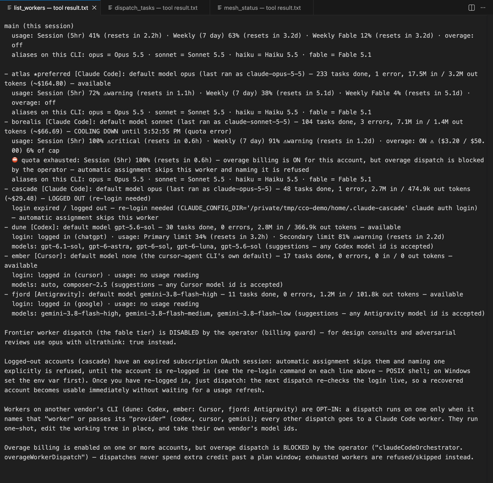
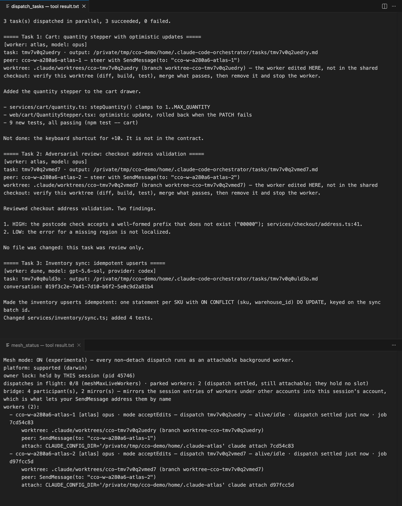
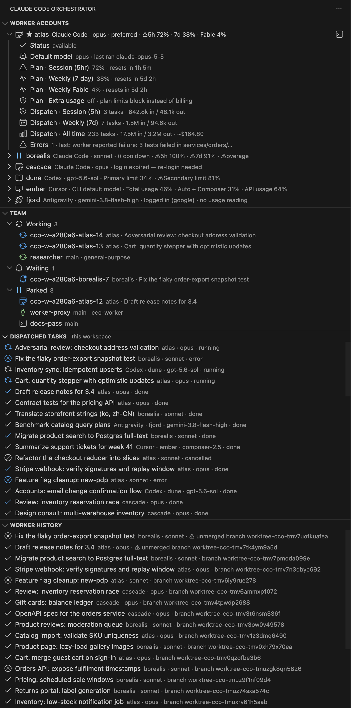
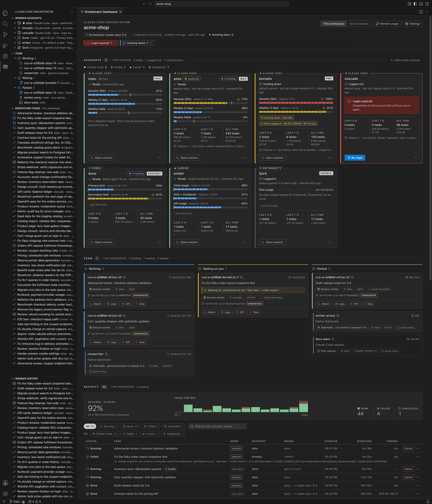

# Claude Code Orchestrator

[English](README.md) | [한국어](README.ko.md) | **简体中文**

[](https://marketplace.visualstudio.com/items?itemName=toragonite.claude-code-orchestrator)
[](https://marketplace.visualstudio.com/items?itemName=toragonite.claude-code-orchestrator)
[](https://open-vsx.org/extension/toragonite/claude-code-orchestrator)
[](https://open-vsx.org/extension/toragonite/claude-code-orchestrator)
[](https://github.com/Toragonite/claude-code-orchestrator/releases/latest)
[](https://github.com/Toragonite/claude-code-orchestrator)
[](LICENSE)


> 非官方扩展 — 与 Anthropic 无关，也未获其认可。曾用名：*Fable Orchestrator*。

把你现有的 **Claude Code** 面板变成多账号编排器。像平常一样与主会话对话；它负责设计与验证，并通过 MCP 调度工具把实现工作**并行**分发给工作账号（Opus / Sonnet — 以及计费防护之后的 Fable）。内置按账号的用量统计（含每个账号实时的真实计划用量与重置时间）、配额感知的自动故障转移，以及实时仪表盘。

> **新增 — Mesh 模式重做：可 attach、以 worktree 隔离的调度（实验性）**
> Mesh 模式不再是一套自带工具的独立工作流。打开后，每个被调度的 worker 都是一个可以用终端 attach 上去的常驻 `claude --bg` 会话，并在**自己的 git worktree** 中干活——也就是说结果会以一个待合并的分支返回——同时编排器可以在任务进行中给它发消息来纠偏，worker 也会把进度报告回来。
> 默认关闭；关闭时调度行为与以前完全一致。需要 Claude Code CLI 2.1.224 及以上版本，仅支持 macOS 或 Linux。 → [Mesh 模式](#mesh-模式实验性)

```
Claude Code 面板（主账号 — 编排器）                ← 照常使用
   │  MCP 工具: dispatch_tasks / dispatch_task / list_workers / orchestrator_briefing
   ▼
cco-dispatch MCP 服务器（注册在工作区 .mcp.json）
   │  以 CLAUDE_CONFIG_DIR=<worker 目录> 运行 Claude Code CLI（同一工作区）
   ├──────────────┬──────────────┐
   ▼              ▼              ▼
worker w1       worker w2      worker w3
(opus-4-8)      (sonnet-5)     (opus-4-8)
```

核心思路：**账号 = 一个 Claude Code 配置目录。** 每个 worker 拥有自己的 `~/.claude-<名称>` 目录；登录一次后，保存的登录状态会被持续复用。扩展本身从不接触令牌或凭据 — 登录与刷新完全由 Claude Code 处理。

## 截图

*会话启动：编排器通过 `orchestrator_briefing` 报到，随后从 `list_workers` 读取每个账号的实时计划用量，避开接近额度上限的账号：*



*并行扇出：编排器先冻结接口约定，再将各个独立子任务一次性批量分发给状态健康的 worker 账号：*



*worker 账号显示每个账号的实时计划配额（Session 5 小时 / Weekly 7 天 / Weekly Fable，各带重置时间），与本扩展自身的调度计数分开呈现，以及实时任务流：*



*仪表盘：统计卡片、活动图表、实时用量面板（按账号显示进度条与重置倒计时）、各 worker 用量，以及包含 frontier 计费防护的设置面板：*



## 环境要求

- VS Code 1.90+
- 已安装并登录 [Claude Code](https://claude.com/claude-code) CLI（主账号）
- 一个或多个用作 worker 的额外 Claude 账号（其订阅计划需支持你分配的模型）

## 安装

- **应用市场**：搜索 “Claude Code Orchestrator”。
- **从源码**：`npm install && npm run compile`，然后按 F5（扩展开发宿主），或 `npm run package` 后安装生成的 `.vsix`。

## 快速开始

1. 打开活动栏的 **Claude Code Orchestrator** 视图 → **Add Worker Account**。输入名称（如 `w1`）并选择默认模型；随后打开的终端里，用该槽位的 Claude 账号**登录一次**。已经有 `~/.claude-*` 目录？用 **Import Existing Claude Config Directories** 批量导入。
2. 运行 **Register Dispatch MCP Server in This Workspace** — 在工作区 `.mcp.json` 写入 `cco-dispatch` 条目（服务器文件位于 `~/.claude-code-orchestrator/mcp/` 下的固定路径，扩展升级不会破坏注册）。
3. 接受向工作区 `CLAUDE.md` 添加**调度策略**的提示（也可以稍后运行 **Add Dispatch Policy to CLAUDE.md**）。
4. 重启 Claude Code 会话并批准该项目的 MCP 服务器。
5. 照常对话。交给主会话一个大任务，它会自动分发：独立的子任务并行派给各 worker，主会话专注于设计、集成与验证。

## MCP 工具

| 工具 | 用途 |
|---|---|
| `dispatch_tasks` | **批量调度（推荐）。** 一次调用交付 N 个独立任务；服务器在各 worker 账号间真正并行执行，并汇总返回结果。 |
| `dispatch_task` | 把一个自包含任务派给一个 worker（在同一工作区运行的无头 Claude Code 会话，具备文件与 shell 访问能力）。 |
| `orchestrator_briefing` | 按 CLAUDE.md 策略，主模型每会话调用一次并传入自己的模型 ID。按工作区记录编排器模型，并返回与其层级匹配的运行简报 — 见下文*模型校准*。 |
| `list_workers` | 各 worker 的默认模型、累计用量（任务、token、费用）、实时计划用量（Session/Weekly/Weekly Fable %，含重置时间）、各账号的超额计费（overage billing）状态（关闭，或开启并显示相对月度上限的当前花费）、可用性/冷却状态，以及 frontier 调度防护的状态。 |

值得了解的调度参数：

- **`system_prompt`** — 编排器可以为每个 worker 下发任务定制的系统提示（角色、质量标准、输出格式），叠加在内置的 worker 基础提示之上。对复杂任务的质量影响显著。
- **`ultrathink: true`** — 机制化地把该次 worker 运行的推理深度拉到最高。适用于契约关键的实现、微妙的调试和对抗性评审。
- **`model`** — 高难度推理/编码用 `claude-opus-4-8`；简单或大批量任务用 `claude-sonnet-5`；`claude-fable-5` 仅用于杠杆最高的调度（设计咨询、对抗性评审），且仅当你已开启 frontier 调度（见*计费防护*）。
- **`worker`** — 可选的显式账号；省略则按配额感知自动分配。
- **`timeout_minutes`** — 可选的单任务壁钟超时时间（分钟，1–480），仅对该次调度覆盖 `workerTimeoutMinutes` 设置。

## 编排质量栈

扩展内置三层提示（所有面向模型的文本均为英文，且不提及任何具体模型名）：

1. **Worker 基础提示** — 自动注入每个被调度的会话：契约纪律（接口具有约束力、文件所有权边界）、自主完成、克制的范围、经证据核对的汇报。
2. **调度策略**（`CLAUDE.md` 区块，在标记注释之间幂等更新）— *主*会话的常驻指令。核心是：**编排器不写实现。** 它只亲自做设计、分解、调度、集成与验证；所有生产代码、测试和文档都由 worker 编写。还包括：批量并行、验证闭环、主动搜寻未知的未知、frontier 升级阶梯、汇报语言规则。
3. **模型校准**（由 `orchestrator_briefing` 返回）— frontier 层级的编排器模型只收到简短确认，保留最大自由度；其他层级会收到校准附录，使其在长程多智能体工作中保持同等运行水准（强制委派、外化计划、可追溯到探针的事前验尸、带否决程序的对抗性评审、文档一致性关卡、基于证据的断言）。

这套栈经过基准调优：在四轮难度递增的双编排器 A/B 构建中（以基于实际执行的探针做盲评），frontier 编排器与校准后的 Opus 编排器之间的评分差距从约 11.5 分收窄到 **3 分，且双方功能缺陷均为零**。详见 [docs/benchmarks.zh-CN.md](docs/benchmarks.zh-CN.md)。

## 配额感知调度与故障转移

- 从 CLI 结果解析各 worker 的累计用量（任务、token、费用）并记录在本地。
- 遇到配额/限流错误时，该 worker 进入可配置的**冷却期**，任务**自动转移**到其他可用 worker。只有一个 worker 时没有转移目标 — 会返回明确的错误。
- **★ 首选 worker** — 把与主会话同账号的 worker 标记为首选（右键 → *Toggle Preferred*）。只要它不比最空闲的替代者更忙，就在自动分配中胜出：受偏好，但不会被淹没。
- 后台 worker 无法回答权限询问，因此默认以 `--permission-mode acceptEdits` 运行（可配置；需要执行 shell 命令的任务要用 `bypassPermissions` — 请先理解其安全影响）。

## 超额计费（overage billing）可见性

Anthropic 的限流窗口（Session 5 小时、Weekly 7 天、Weekly Fable）在触达上限后如何表现，取决于该账号是否开启了**超额计费（overage billing）**。**关闭**时，触达窗口上限只会阻塞后续工作，直到该窗口重置——上文的冷却与自动故障转移会照常处理，且不会产生超出订阅计划本身的费用。**开启**时，超出窗口上限的工作会转为按该账号的月度上限计费，也就是说超出窗口的调度会开始产生实际花费。

扩展会在 `list_workers`、Worker Accounts 树以及仪表盘的用量卡片中展示每个账号的超额计费状态，并通过 `claudeCodeOrchestrator.overageWorkerDispatch` 设置保护调度：默认值 **`block`** 绝不会把工作分配给配额已耗尽的 worker——即便该账号开启了超额计费（因此调度不会产生超出计划窗口的费用）；**`allow`** 允许把它作为最后手段使用，此类调度会产生实际费用。（下文针对 `claude-fable-5` 的 frontier 计费防护是另一套机制，未受影响。）

## Frontier 计费防护

取决于订阅计划，`claude-fable-5` 可能**按用量计费**而不是消耗订阅配额。由于调度是自主发生的（策略规定的设计咨询可能在你不注意时发出），防护**在调度服务器强制执行，而非仅靠提示词**：

- 默认：**block** — 拒绝 frontier 调度，并返回引导性错误，把编排器导向 `claude-opus-4-8` + `ultrathink`（不重试、不转移）。
- `list_workers` 与工具 schema 会在任何调度尝试之前展示防护状态。
- 需要时再有意打开：`claudeCodeOrchestrator.frontierWorkerDispatch` 设置，或仪表盘中的下拉框。一个行之有效的外科式用法：打开 → 为重要构建调度一次对抗性评审 → 关闭。

## Mesh 模式（实验性）

Mesh 模式不是"第二种干活方式"，它改变的是**调度本身是什么**：打开后，每个被调度的 worker 都以可 attach 的常驻 `claude --bg` 后台会话运行，而不是一次性执行；在 git 工作区里，它还会在自己的 git worktree 中干活。你照旧使用 `dispatch_task` / `dispatch_tasks`，结果、超时、取消、配额感知的故障转移都和以前一样。没有额外的 mesh 工作流需要学习。

它带来什么：你可以用终端 attach 到正在运行的 worker 上观察它，编排器可以在任务进行中给它发消息纠偏，worker 也会在干活的同时把进度和问题报告回来。

Mesh 模式**关闭**时，调度与此前版本完全一致——每个任务一个一次性 worker，走的是没有改动的代码路径。

### 结果以一个待合并的分支返回

这是用户能看到的最大变化。在 git 工作区里，每次调度都会得到自己的 worktree：`.claude/worktrees/cco-<taskId>`，检出在分支 `worktree-cco-<taskId>` 上（这是 Claude Code 自带的 `-w` worktree 能力）。worker 在**那里**改文件，而不是在你的共享检出里，调度结果中会写明 worktree 路径与分支。编排器收到的常驻指令是：在那个 worktree 里验证（diff、构建、测试），把通过的合并进来，然后移除 worktree 并停止 worker——分支没有被合并之前，这次调度就不算完成集成。

有两种情况**没有** worktree，此时结果里干脆没有 worktree 那一行，因为改动已经落在你的工作树里了：

- 工作区不是 git 仓库；
- 该次调度回退成了一次性 worker（见下文*mesh 无法启动时*）。

未合并的成果不会被替你清理掉：停止一个 worker 时会请求 Claude Code 移除它的 worktree，而 Claude Code **只会移除干净的 worktree**。含有未提交改动的 worktree 会被保留，并继续出现在 `mesh_status` 的列表里（标记为已保留），方便你找到它。

### 和正在运行的 worker 对话

| 工具 | 用途 |
|---|---|
| `mesh_status` | 主要界面：中继健康状况、未读的实时消息与待答的 worker 提问、当前存活 worker 数与上限、空闲自动停止时长，以及每个 worker 的调度任务、账户、模型、存活状态、空闲时长、keep-alive 标记、worktree（因含未提交改动而被保留时会标出）和可直接复制的 attach 命令。 |
| `mesh_send_worker` | 给本工作区中**某一个**正在运行的 worker 发实时消息：纠正、新发现的约束、对它提问的回答，或让它放弃错误路线。 |
| `mesh_receive` | 长轮询本工作区各 worker 的实时消息流——进度说明，以及它们以 `STATUS <id> QUESTION: …` 形式提出的问题（会被高亮）。结果完成 ping 在内部消费，不会出现在这里。 |
| `mesh_stop_worker` | 停止一个 worker（在其账户下执行 `claude stop`，随后用 `claude rm` 清理后台作业并移除干净的 worktree）。 |
| `mesh_keep_worker` | 给 worker 打上 keep-alive 标记，使空闲自动停止不会动它——在把 attach 命令交给用户之前就要设置。会话结束时的回收仍然照常生效。 |

v1.4 的那些工具已经不在了。`mesh_spawn_workers` 不复存在（现在由调度来启动 worker），可以寻址任意对端会话的 `mesh_send` 也一样。`mesh_receive` 名字保留但含义变了：它是*本工作区自己的调度 worker* 的实时消息流，而不是通用的对端收件箱。worker 之间的点对点消息已经退役——`mesh_send_worker` 会拒绝任何不是本工作区存活 worker 的名称。

消息会排队，并在 worker 的下一个回合边界送达，因此纠偏不会打断正在进行的工具调用。一条纠偏消息可以修改任务内容，与原任务冲突时以更新的指令为准；但它无法扩大 worker 的文件所有权清单，而且 worker 收到的消息内容始终被当作数据，而不是指令。

### 两条通道：结果走文件，纠偏走消息

worker 的报告通过调度服务器读取的**结果文件**返回，实时消息通道只承载简短的完成 ping、进度说明和纠偏内容。这个拆分是刻意的——中继挂掉时，你失去的是纠偏和进度说明，而不是结果。待完成的调度依然会由结果文件收尾，`mesh_status` 也会这么告诉你（"ping/STATUS channel lost; results still collected via files"）。进度说明在设计上就是尽力而为：worker 被要求发送它们，但没有任何机制依赖它们送达。

### 收尾 —— 一个存活的 worker 是被占用的资源

worker 在调度返回后**不会消失**，这正是可 attach 的意义所在，也意味着必须有人去停止它。编排器被要求在成果合并后就停止对应 worker，下面还有三道兜底：

- **空闲自动停止** —— `claudeCodeOrchestrator.meshWorkerIdleTimeoutMin`（默认 `15`，设为 `0` 则关闭）。一个没有进行中的调度、没有消息、也没有 keep-alive 标记的存活 worker，会在这么多分钟后被停止。从 **Attachable workers** 树里 attach 会先打上 keep-alive 标记，所以你正在里面操作的会话不会被回收（若该标记写入失败，会弹出警告告知）；编排器一侧由 `mesh_keep_worker` 做同样的事。
- **存活 worker 上限** —— `claudeCodeOrchestrator.meshMaxLiveWorkers`（默认 `8`）。超过上限的调度会被**直接拒绝，而不是排队**：该任务以写明上限的 `worker_cap` 错误失败，这样一批任务就不会为了等谁也不会释放的名额而死锁。大规模并行之前先停掉已完成的 worker，或者把这个数字调大。
- **会话结束** —— 调度服务器关闭时会停止它拥有的所有 worker（包括打了 keep-alive 标记的），下一次激活还会清扫被强杀会话遗留的孤儿 worker，把仍然存活的停掉。

停止 worker 时也会清理它的后台作业（干净的 worktree 就是在这一步被移除的），因此一次触发超时的调度，可能比超时时刻本身晚约 30 秒才报告出来（停止与作业移除各自都有 15 秒上限）。

### 如何启用

Mesh 模式默认关闭。下面五个设置在编排器仪表板的 Settings 卡片里也有，改动会在该工作区的下一个 Claude Code 会话生效。

| 设置 | 默认值 | 作用 |
|---|---|---|
| `claudeCodeOrchestrator.meshMode` | `false` | 总开关：启动中继会话，并把所有非 detach 的调度都交给可 attach 的 worker |
| `claudeCodeOrchestrator.meshGatewayModel` | `haiku` | 中继会话使用的模型，它只执行极小的中继回合 |
| `claudeCodeOrchestrator.meshWorkerIdleTimeoutMin` | `15` | 空闲的可 attach worker 多少分钟后被停止；`0` 表示关闭 |
| `claudeCodeOrchestrator.meshMaxLiveWorkers` | `8` | 同时存活的可 attach worker 上限；超出的调度会被拒绝而不是排队 |
| `claudeCodeOrchestrator.meshHistoryLimit` | `50` | Worker History 视图保留的已停止 worker 记录数量，超出后从最旧的开始丢弃（最小 `1`，最大 `1000`） |

`meshCrossAccountBridge` 设置已被移除。它原先控制的跨账户镜像依然在工作（正是它让某个账户下的 worker 能够触达另一个账户下的中继），但现在它是随 mesh 一起启动的内部管道，而不是需要用户选择开启的功能。`mesh_status` 会用一行报告它。

### mesh 无法启动时

如果 mesh 因为任何原因无法初始化——平台不支持、本工作区的 mesh 已被另一个窗口占用、中继起不来——调度**不会失败**。它会作为普通的一次性 worker 运行，结果前面会加上：

```
⚠ mesh unavailable — ran as a one-shot worker (not attachable): <原因>
```

`mesh_status` 会持续报告这个初始化错误；这类调度没有 worktree——改动直接落在工作树里。

### 环境要求与如实说明

- **Claude Code CLI 2.1.224 或更新版本**（跨会话消息机制从这个版本起默认开启）；本节描述的 worktree 行为是在 2.1.227 上验证的。
- **仅 macOS 或 Linux，且同一台机器。** mesh 运行在 unix domain socket 之上，因此在 Windows 上它根本不会启动，所有调度都走上面那条一次性回退路径。
- **可 attach 的 worker 只写文件，不跑你的构建。** 它们在启动时没有 Bash 工具（Claude Code 仍可能自动批准明显安全的只读命令，所以请把它们当作"写文件的人"，而不是沙箱），而且本工作区的 MCP 服务器对它们是禁用的，所以 worker 无法再去调度别的 worker。构建、测试和 shell 工作仍然属于编排器。
- **`detach: true` 依旧是一次性。** detach 任务的意义是活得比会话更久，而中继并不会，所以即使打开 Mesh 模式，detach 调度仍走原来的监管路径。
- **中继会花一点钱。** Mesh 模式打开期间，服务器会在你的主账户上维持一个小的 `claude -p` 中继会话（`meshGatewayModel`，默认 `haiku`）。它只中继简短消息，但并非免费。
- **没有按任务的 token 与费用数字。** CLI 不会报告 `--bg` 会话的用量，因此可 attach 的调度在本扩展自己的计数与图表中记为 0 token、0 费用，任务输出里写的是 `tokens n/a`。各账户的实时套餐用量不受影响——那是直接从账户读取的。
- **可能残留 worktree。** 如果会话在移除动作执行之前就结束，干净的 `cco-…` worktree 可能会堆积在 `.claude/worktrees/` 下，可以用 `git worktree remove` 安全删除。另外在 worker 刚完成工作之后，确实干净的 worktree 偶尔会被报告为*已保留*——不会丢任何东西，过几秒再移除就会成功。
- **失败后的重试会复用同一个任务 worktree**，因此同一个分支可能同时包含两次尝试的改动；合并前请通读整个 diff。
- **它依赖没有公开 API 的 Claude Code 内部机制**（会话注册表与后台作业命令）。这些内部一旦变动，mesh 初始化会失败，调度回退成一次性 worker；若变动发生在调度进行中，它表现为超时或 worker 死亡错误，而不是错误的结果。

### 已知的上游限制

- **IDE 面板会话无法直接加入 mesh** —— 它注册时没有消息 socket，因此既无法接收消息，自己发出的消息也会静默投递失败。这正是 Mesh 模式要单独启动一个后台中继会话作为编排器 mesh 身份的原因。上游 issue：[anthropics/claude-code#82313](https://github.com/anthropics/claude-code/issues/82313)。
- **VS Code 扩展会忽略 `CLAUDE_CONFIG_DIR` 覆盖**，始终解析为 `~/.claude`——这也是跨账户可达性通过镜像注册表文件、而不是让扩展宿主直接看到其他账户来实现的原因之一。上游 issue：[anthropics/claude-code#30538](https://github.com/anthropics/claude-code/issues/30538)。

本功能所依托的消息机制验证（探针 P1–P11）见 [docs/session-messaging-spike.md](docs/session-messaging-spike.md)；该文档中的工具列表早于这次重做。

## 视图与仪表盘

- **Worker Accounts** — 展开一个 worker 可见状态（可用/冷却中）、实时计划用量（Session 5h、Weekly 7d 与 Weekly Fable 使用率，各带重置时间，通过 Claude Code 的 `get_usage` 获取）、本扩展自身的会话（5h）与每周（7d）调度用量、历史累计和错误数。计划用量不仅覆盖各 worker，也覆盖主账号，并在激活时与每 5 分钟自动刷新一次（也可通过 **Refresh Account Usage** 立即刷新）。调度用量数字是单独的一项，只反映本扩展发出的任务，并非该账号的全部消耗。通过 `claude setup-token` 等非订阅凭证登录的账号没有关联的计划，会显示 “no plan limits”。**Rename Worker Account**（上下文菜单）只修改 worker 的标签 —— 配置目录与登录状态不受影响 —— 且在任何调度运行期间会被拒绝。如果上游用量数据源短暂返回空值，扩展会保留上一次的有效读数并标记为 stale（过期，附带经过的时长），最长保留 30 分钟，而不是直接消失。
- **Dispatched Tasks** — 实时任务流，默认只显示当前工作区（可切换为全部工作区）。点击任务可打开其提示词/结果的 markdown。运行中的行带有内联的 **Cancel Dispatched Task** 按钮；视图标题栏上的 **Cancel All Running Dispatches** 按钮会先询问确认。
- **编排器仪表盘**（编辑器标签页）— 统计卡片（运行中、7 天任务、成功率、token、费用）、实时用量面板（每个计划窗口一条进度条，含百分比、严重程度颜色、重置倒计时，以及”N 分钟前更新”的新鲜度提示）、14 天任务图表、各 worker 的 token 分布、worker/任务表格，以及带快捷操作的设置面板。每 2 秒自动刷新，自动适配主题。运行中的行带有 Cancel 按钮，取消所有运行中的调度也作为一项快捷操作提供。
- **Open Interactive Worker Session** — 在集成终端中以可见方式运行 worker（可注入初始任务），适合需要盯着并随时介入的工作。

停止调度确实会真正停止：按下 Stop 会取消对应的 MCP 请求，并终止该 worker 的整个进程树（通过 `dispatch_tasks` 发出的批量调度是同一个请求，因此取消它会停止批次中的所有任务）。打开 Mesh 模式时，取消会停止该 worker 的后台会话，而不是向进程树发信号；它此前写下的内容仍然留在磁盘上。结束编排器会话——关闭面板、重新加载、退出，或强制结束进程——会终止它启动的所有 worker，而不是任其挂到 `workerTimeoutMinutes` 壁钟超时。扩展只会向已核实仍属于自己 worker 的进程 ID 发信号（绝不会误杀被操作系统回收复用的进程 ID），取消操作从不计入 worker 错误或配额冷却，任何仍标记为运行中、但其 worker 已消失的任务会在下次激活时被回收为孤儿任务。

## 资源包与 Asset Manager

**资源包**是一个直接镜像 `.claude/` 目录结构的普通目录 — `skills/`、`agents/`、`commands/`、`output-styles/`、`hooks/` — `pack.json` 是可选的。资源包分两种：扩展内置的**内置包**，以及在 `claudeCodeOrchestrator.assetPacks` 设置中列出的**用户包**（例如一个私有仓库的本地克隆）。

资源按工作区逐个启用；启用后会安装到该工作区的 `.claude/` 目录，这一选择记录在 `.claude/cco-assets.json` 中 — 这是 sync 用来追踪自己写过哪些文件的所有权台账。

**Sync** 会安装并更新已启用的资源，但绝不会覆盖你手动编辑过的文件 — 那个文件会被标记为 "customized"。禁用某个资源时，只会删除 sync 自己写入的文件，你的自定义版本会原样保留。**Reset** 是显式的强制覆盖出口，可以把单个文件或整个资源恢复成资源包中的版本。

**Asset Manager 面板**（**Open Asset Manager**）是管理这一切的地方：添加或移除资源包目录、按工作区切换资源启用状态，并查看每个资源的状态徽标：

| 徽标 | 含义 |
|---|---|
| synced | 已安装，且与资源包一致 |
| update available | 资源包已有更新的版本 |
| customized | 已安装文件被手动修改过 — sync 不会碰它 |
| conflict | 两个已启用的资源争用同一个安装路径 |
| not installed | 已启用但尚未同步 |

面板中还可以对不同步的文件进行 diff 或 reset、清理孤立（orphan）的已安装文件，并用 **New asset…** 快速生成新的 skill、agent、command、output style 或 hook 骨架（写入某个可写的资源包 — 内置包在此处是只读的）。

**Hook 是脚本，不是 markdown。** 安装 `hook` 资源只会把脚本文件写入磁盘，并不会自动注册它 — 你仍需自己把它加进 `.claude/settings.json` 的 `hooks` 区块；脚手架的注释里给出了确切的写法。

**隐私提示：** 放进扩展自身内置 `assets/` 里的任何内容，会在扩展发布的那一刻起变为公开。个人或团队私有的资源应放在单独的资源包目录中，通过 `assetPacks` 注册。

随时运行 **Sync Assets** 拉取资源包更新。`claudeCodeOrchestrator.assetAutoSync`（默认开启）会在激活时静默完成这一操作，只有真正发生变化时才会弹出通知。

## 命令

| 命令 | 说明 |
|---|---|
| Add Worker Account | 创建 worker（配置目录 + 一次性登录终端） |
| Import Existing Claude Config Directories | 扫描 `~/.claude*` 并批量注册 |
| Register Dispatch MCP Server in This Workspace | 向 `.mcp.json` 写入 cco-dispatch |
| Add Dispatch Policy to CLAUDE.md | 注入/刷新策略区块 |
| Open Worker Session in Terminal | 交互式 worker 会话（条目上的内联按钮） |
| Re-login Worker Account | 重新登录 worker（上下文菜单） |
| Toggle Preferred Worker | 自动分配时偏好此 worker（上下文菜单） |
| Rename Worker Account | 在注册表、用量统计与任务日志中重命名 worker；配置目录与登录状态不受影响（上下文菜单） |
| Refresh Account Usage | 重新获取所有账号的实时计划用量（Worker Accounts 视图的工具栏按钮） |
| Open Orchestrator Dashboard | 编辑器标签页仪表盘 |
| Toggle Task Scope | 任务视图：当前工作区 ↔ 全部 |
| Cancel Dispatched Task | 终止某个运行中调度的 worker 进程（Dispatched Tasks 视图与仪表盘中行上的内联按钮） |
| Cancel All Running Dispatches | 确认后终止所有运行中的调度（Dispatched Tasks 视图标题栏按钮；仪表盘中的快捷操作） |
| Remove Worker Account / Clear Task History | 清理 |

## 设置

| 设置 | 默认值 | 说明 |
|---|---|---|
| `claudeCodeOrchestrator.workerPermissionMode` | `acceptEdits` | 后台 worker 的 `--permission-mode`（`default` 会因等待编辑批准而卡住） |
| `claudeCodeOrchestrator.claudePath` | `claude` | Claude Code CLI 路径 |
| `claudeCodeOrchestrator.quotaCooldownMinutes` | `30` | 配额错误后该 worker 被排除出分配的分钟数 |
| `claudeCodeOrchestrator.workerTimeoutMinutes` | `45` | 每次调度的壁钟超时时间（分钟，1–480）；可通过 `timeout_minutes` 按次调度覆盖 |
| `claudeCodeOrchestrator.frontierWorkerDispatch` | `block` | frontier worker 模型的计费防护（见上文） |
| `claudeCodeOrchestrator.overageWorkerDispatch` | `block` | 超额计费调度防护：`block` 下即便超额计费已开启也绝不把工作分配给配额已耗尽的 worker；`allow` 允许将其作为最后手段使用，并会产生实际费用 |
| `claudeCodeOrchestrator.sessionKeepalive` | `false` | 每个订阅账号每 24 小时发送一次最小化的 `haiku` 请求，以保持 OAuth 会话新鲜 |
| `claudeCodeOrchestrator.assetPacks` | `[]` | 内置包之外、用于加载资源的额外资源包目录 |
| `claudeCodeOrchestrator.assetAutoSync` | `true` | 激活时静默同步已启用的资源，只有实际发生变化时才弹出通知 |

Mesh 模式还新增了五个设置（`meshMode`、`meshGatewayModel`、`meshWorkerIdleTimeoutMin`、`meshMaxLiveWorkers`、`meshHistoryLimit`）—— 见 [Mesh 模式](#mesh-模式实验性)。

## 数据与隐私

一切都留在你的机器上。扩展与服务器在 `~/.claude-code-orchestrator/` 下共享状态：worker 注册表（名称、配置目录路径、默认模型 — **不含令牌、不含凭据**）、各 worker 的用量统计、任务日志，以及 markdown 格式的任务产出。除了你主动调度的 Claude Code CLI 调用之外，不向任何地方发送任何数据。卸载扩展后该目录会保留 — 彻底清除请手动删除。

## 疑难解答

- **MCP 服务器显示 “failed”** — 通常是 GUI 进程的 Node.js 路径问题。重新运行 *Register Dispatch MCP Server*；扩展会通过登录 shell 解析 `node` 的绝对路径并写入 `.mcp.json`。
- **worker 卡住直至超时** — 检查 `workerPermissionMode`；`default` 会永远等待一个无人能点击的权限批准。任务在 `claudeCodeOrchestrator.workerTimeoutMinutes`（默认 45，范围 1–480）后超时；单次调度可用 `timeout_minutes` 工具参数覆盖该值。
- **“Dispatch to claude-fable-5 is blocked”** — 计费防护处于开启状态（默认）。若接受费用，请有意将 `frontierWorkerDispatch` 设为 `allow`。
- **每次调度都报配额错误** — 在 `list_workers` / Worker Accounts 视图检查冷却状态；只有一个 worker 时没有故障转移。

## 限制与说明

- 各 worker 会并发修改**同一工作区**的文件。对可能重叠的任务，请在提示词中划分互不相交的文件所有权清单。（在 git 工作区里打开 [Mesh 模式](#mesh-模式实验性)后，每次调度改为隔离在自己的 worktree 中，你再去合并分支。）
- 不会动你的主账号 — 面板继续使用默认的 `~/.claude` 登录。
- 使用多个 Claude 账号需遵守 Anthropic 的服务条款与使用政策。**确保你的账号配置与使用方式合规是你自己的责任。** 被调度的工作消耗的是各 worker 账号自己的配额或按量计费。

## 许可证与商标

[MIT](LICENSE) © 2026 Toragonite。

Claude、Claude Code 与 Anthropic 是 Anthropic, PBC 的商标。本项目是独立的社区扩展，与 Anthropic 没有从属、赞助或背书关系。
